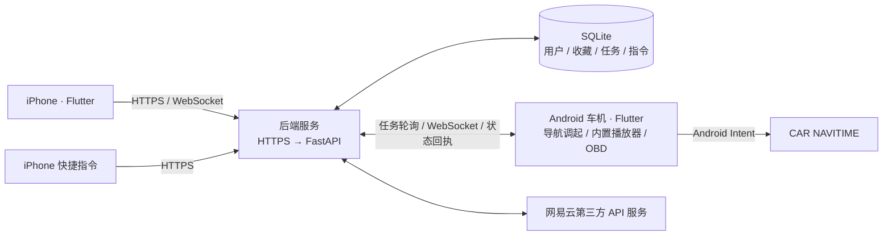

<div align="center">

# 🚗 MyYaris

**让 iPhone 与 Yaris 车机协同工作**

导航目的地流转 · 远程音乐控制 · 地址收藏 · 车辆数据探索


[车机与项目文档](https://github.com/JamesXiaoMo/MyYaris) · [iPhone 客户端](https://github.com/JamesXiaoMo/MyYaris-iOS) · [后端服务](https://github.com/JamesXiaoMo/MyYaris-Backend)

</div>

---

面向个人丰田 Yaris 使用场景的手机与车机互联系统，由 Flutter iPhone 客户端、Flutter Android 车机应用和 Python 后端组成。手机发送目的地或音乐控制指令，后端保存并分发任务，车机执行并回传状态。

项目由手机端、Android 车机端与可自行部署的后端组成，不绑定特定车机盒子或服务器型号。设备间可通过 Tailscale 私有网络连接。

## 系统架构



使用 Tailscale Serve 时，HTTPS 入口仅在对应 Tailnet 内可达；客户端仍验证 HTTPS 证书。此部署方式不等于将服务公开到互联网。

## 功能概览

| 模块 | 当前实现与范围 |
| --- | --- |
| 用户账户 | 用户名与密码登录、会话管理、头像和设备控制权限；车机使用独立设备凭据。 |
| 目的地流转 | 经纬度、Google Plus Code 和地图链接解析；存在歧义时要求澄清或确认，再创建导航任务。 |
| 地址收藏 | 保存地址与 WGS84 经纬度到后端数据库，供手机读取和维护。 |
| 音乐 | 手机搜索在线歌曲、读取“我喜欢的音乐”分页列表，向车机内置播放器发送播放、暂停、进度、音量和循环控制。网易云能力依赖第三方服务及账号状态。 |
| 车机 | NAVITIME 调起、后台连接与状态同步、默认全屏及设置开关。 |
| iOS 界面 | 四个主要页面、可水平旋转的首页 3D 车辆模型、Flutter 玻璃效果底栏。 |
| OBD | 车机端包含蓝牙连接与遥测仪表代码；具体车型、适配器及 PID 支持情况需要实车验证。 |

任务回执代表对应阶段的执行结果。`launch_requested` 仅表示请求打开导航；音乐列表加载成功或指令回执不能单独证明扬声器已实际出声。地图链接也不保证包含所选地点的精确坐标。

## 目录结构

```text
MyYaris/
├── car_app/     # Flutter Android 车机端
├── ios_app/     # Flutter iPhone 客户端，独立 Git 仓库
├── backend/     # FastAPI + SQLite 后端，独立 Git 仓库
├── docs/        # 共享需求、接口契约、研究与验证记录
└── deploy/      # 辅助部署配置
```

三个仓库分别保存代码和提交历史：**MyYaris**（车机与共享文档）、**MyYaris-iOS**（手机端）、**MyYaris-Backend**（后端）。

本地工作区的根 Git 仓库跟踪 `car_app/`、`docs/` 和 `deploy/`；`ios_app/`、`backend/` 各自维护 Git 历史，并被根仓库忽略。因此，仅克隆根仓库不会自动获得两个独立子项目，发布时需要明确包含范围。

## 本地开发

### Flutter 客户端

两个客户端的 `pubspec.yaml` 当前要求 Dart `^3.12.2`，请使用兼容的 Flutter SDK。Android 开发需要 Android SDK；iOS 构建需要 macOS、Xcode 和对应 SDK。

在目标工程目录分别执行：

```bash
cd car_app  # 或 ios_app
flutter pub get
flutter analyze
flutter test
flutter run
```

iPhone 真机安装还需要 Apple 签名、设备信任和开发者模式。免费个人团队签名存在有效期限制，不能用自签 HTTPS 证书替代 Apple 的应用签名。

### 后端

```bash
cd backend
python3 -m venv .venv
source .venv/bin/activate
pip install -r requirements.txt
cp .env.example .env
# 启动前按实际环境配置 .env 中的设备凭据、认证与外部服务。
uvicorn app.main:app --host 127.0.0.1 --port 8000
```

本机接口文档：`http://127.0.0.1:8000/docs`；健康检查：`GET /health`。

```bash
cd backend
.venv/bin/pytest
```

Linux 部署可使用 systemd 管理服务，并由 Tailscale Serve 代理到回环地址。数据库、头像、缓存和配置文件应放在运行环境中，不纳入源码仓库。

## 文档入口

- [三端 API 契约](docs/API-V2三端契约.md)
- [后端 API 参考](https://github.com/JamesXiaoMo/MyYaris-Backend/blob/main/docs/API参考.md)
- [用户账户与认证迁移](docs/用户账户API与迁移方案.md)
- [收藏夹接口契约](docs/收藏夹API契约.md)
- [iPhone 快捷指令配置](docs/iPhone快捷指令配置.md)
- [iPhone 自用签名与安装研究](docs/iPhone-App-自用签名与安装可行性.md)
- [OBD 首次只读测试指南](docs/OBD到货首次只读测试指南.md)
- [Yaris 2022 Z OBD 数据调研](docs/Yaris2022Z-OBD数据可读性调研.md)

历史研究和验证记录描述的是记录时的版本与设备状态，当前行为以对应代码、配置和实际测试为准。

## 凭据与资源

不要提交 `.env`、密码、会话凭据、网易云 Cookie、SQLite 数据库、私钥、Apple 签名材料或个人设备资料。示例配置只使用占位值。

车辆模型、UI 参考图、商标和第三方组件分别受其权利人条款约束。项目没有声明统一的开源许可证；网易云第三方接口并非官方公开 API，歌曲访问与播放受账号权限及服务可用性影响。

## GitHub 同步约定

三个工程各自在所属仓库提交。完成改动和必要检查后，将本地提交推送至对应 GitHub 仓库；存在网络、认证或远端冲突时报告原因，不强制覆盖远端。正在开发、尚未验证的修改不混入其他任务的提交。
