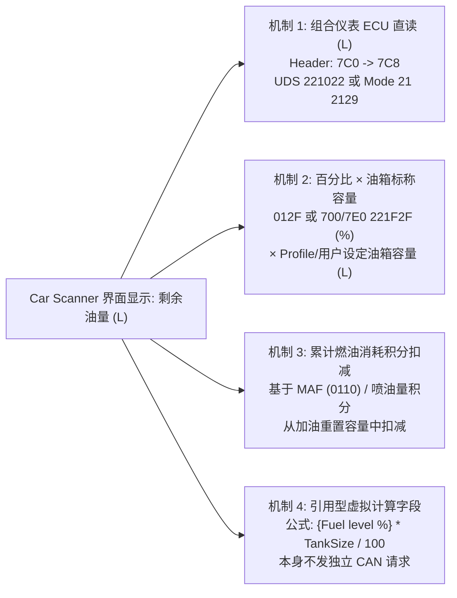
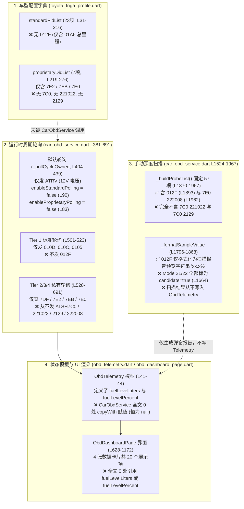

# 日本版 2022 Toyota Yaris Z 1.5L 混动（MXPH10/MXPH15）剩余油量（L）OBD 可读性与 Car Scanner 差异深度研究

- **文档状态**：只读源码审计与一手资料调研报告（未修改业务代码、未重编译、未连接实车发送任何指令）
- **调研基线提交**：`d2cb8d0`（`main` 分支）
- **目标车型**：日本本土版（JDM）2022 款 Toyota Yaris Hybrid Z（1.5L THS-II 混动，型式 `6AA-MXPH10` 2WD / `6AA-MXPH15` E-Four，发动机 `M15A-FXE`，标称油箱容量 `36 L`）
- **目标硬件链路**：Veepeak OBDCheck BLE+（`B07VP1NHHX`，双模蓝牙 4.0，ELM327 兼容）$\rightarrow$ Ottocast P3 Pro（Android 车机盒）
- **已知外部对照信息**：同车使用 **Car Scanner ELM OBD2**，所选连接配置（Connection Profile）全称为 **`Toyota Corolla Hybrid 2020-, RAV4 Hybrid 2019-, Camry Hybrid 2018-, Avalon Hybrid 2019-`**，界面可显示油箱剩余油量升数（单位 `L`）。

---

## 核心结论先行

1. **`MyYaris` 当前无法显示剩余油量（`L` 或 `%`）的直接原因是代码全链路未请求、未赋值、未渲染，而非已证实“车辆不支持”**：
   - 在基线提交 `d2cb8d0` 中，`MyYaris` 的初始化、后台周期轮询（Tier 1～Tier 4）以及 57 项只读深度扫描（`runDeepScan`）**均从未向组合仪表 ECU（请求地址 `0x7C0` / 响应地址 `0x7C8`）发送过任何指令**，代码中完全不存在 `ATSH7C0`、`221022` 或 `2129`。
   - 标准 Mode 01 油箱液位百分比 `012F` 与发动机 ECU 候选 `7E0 -> 222008` **仅存在于手动触发的 57 项 `runDeepScan` 探测列表中，不在常规周期轮询列表内**；且 `CarObdService` 中**没有任何一处代码调用 `copyWith(fuelLevelLiters: ...)` 或 `copyWith(fuelLevelPercent: ...)`**，`ObdDashboardPage` 界面也**没有任何组件绑定这两个字段**。
   - 历史文档中记录的“固定 57 项候选、35 项有响应”（见 `car_app/docs/obd-scan-evidence.md`）仅代表历史固定探测子集的单次快照（且当前仓库与本地归档中均无该 57 项的逐项原始日志），**绝不代表全车 ECU 能力边界**。
2. **Car Scanner 显示剩余升数（`L`）存在 4 种技术路径，仅凭界面显示 `L` 不能直接断定是 ECU 原生升数直读**：
   - Car Scanner 的 `Toyota Corolla Hybrid 2020-, RAV4 Hybrid 2019-, Camry Hybrid 2018-, Avalon Hybrid 2019-` 车型配置支持：（A）直接读取组合仪表 ECU `0x7C0 -> 0x7C8` 的扩展 DID/PID（如 UDS `221022` 或 Toyota Mode 21 `2129`）；（B）读取油位百分比（如 `012F` 或 `700`/`7E0` `221F2F`）再乘以配置/用户设定的油箱标称容量；（C）基于 MAF/喷油速率积分的累计消耗扣减估算；（D）通过 `{传感器名称}` 或 `PID(ID)` 引用其他传感器计算的虚拟字段。
   - **重要交叉印证线索**：上述 Car Scanner Profile 原本面向 TNGA-C/K 平台混动车型（Corolla Hybrid 油箱约 `43 L`、Camry/Avalon Hybrid 约 `50 L`、RAV4 Hybrid 约 `55 L`），而日本版 Yaris Hybrid（TNGA-B 平台 `MXPH10`/`MXPH15`）官方标称油箱容量为 **`36 L`**。若用户未在 Car Scanner 设置中手动将油箱容量改为 `36 L`，而界面满油附近仍显示符合 Yaris 实际的 `~36 L`（而非 43～55 L），则高度指向组合仪表 `0x7C0 -> 0x7C8` 的原生升数直读（`221022` 或 `2129`）；反之若依赖油箱容量设置，则为百分比折算或油耗积分。**最终定性必须以 Car Scanner 传感器详情页或导出的 `elm327.log` 原始请求/响应为准。**
3. **丰田组合仪表 `0x7C0 -> 0x7C8` 剩余油量候选指令具有明确协议定义，但属社区逆向候选而非丰田官方公开规范**：
   - **候选 1（TNGA 世代主流）**：Header `7C0`（响应 `7C8`），UDS Mode `0x22` 指令 `221022`（正响应 `62 10 22 AA BB`，2 字节无符号大端整数），公式为 $\text{Fuel (L)} = \frac{256 \times A + B}{100}$（精度 `0.01 L`，`0xFFFF` 即 `655.35` 为无效值标记 `nullmax`）。
   - **候选 2（丰田旧款/兼容 Mode 21）**：Header `7C0`（响应 `7C8`），Toyota 增强诊断 Mode `0x21` 指令 `2129`（正响应 `61 29 AA`，1 字节无符号整数），公制公式为 $\text{Fuel (L)} = \frac{A}{2} = 0.5 \times A$（精度 `0.5 L`；美制加仑写法为 $\frac{500 \times A}{3785}\text{ gal}$）。
   - 上述两条指令在开源社区信号库 `OBDb`（`Toyota-Yaris`、`Toyota-Corolla-Hybrid`、`Toyota-RAV4`、`Toyota-Camry-Hybrid`、`Toyota-Avalon`）中均有一致定义，但 **`OBDb` 不是丰田官方维修手册（GTS+ / Techstream），其仓库内的 YAML 测试用例仅用于 CI 解析器校验，不能当作本车实测证据**。
4. **标准 SAE J1979 Mode 01 指令边界与既有文档纠偏**：
   - `012F`（Fuel Tank Level Input）按 SAE J1979 标准仅返回 1 字节液位百分比（$\frac{100 \times A}{255}\text{ \%}$），**物理上不可能直接返回升数 `L`**。
   - `01A6`（Odometer）为 4 字节累计总里程（单位 `0.1 km`），**与剩余油量完全无关**。
   - 既有文档 `docs/Yaris2022Z-OBD数据可读性调研.md` 第 93 行将 `012F` 标为“条件候选 / 大概率不支持（常返回 NO DATA）”，目前**缺乏本车实测 `NO DATA` 证据支撑**，应纠正标注为“**本车未实测验证（即使本车支持 `012F`，也仅能提供百分比 `%`，不能直接提供升数 `L`）**”。

---

## 事实 / 候选 / 本车未验证 分级总表

| 类别 | 编号 | 具体结论或条目 | 证据来源与核验位置 |
| :--- | :--- | :--- | :--- |
| **已核实事实（Verified Facts）** | F-01 | 日本版 2022 Yaris Hybrid Z（`MXPH10` 2WD / `MXPH15` E-Four，发动机 `M15A-FXE`）官方标称油箱容量为 **`36 L`**（参考值），燃油残量警告灯触发阈值为剩余约 **`5.4 L`**（即标称容量的 15%）。 | 丰田日本官方电子取扱说明书（2022/07–2023/12 版）第 8 章 `vhch08se010401.php` 与第 7 章 `vhch07se020402.php` |
| **已核实事实（Verified Facts）** | F-02 | SAE J1979 Mode 01 `012F` 仅定义 1 字节油箱液位百分比（$A \times 100 / 255\text{ \%}$，范围 `0%`～`100%`）；Mode 01 `01A6` 定义 4 字节总里程（km），与油量无关。 | SAE J1979 规范 / CSS Electronics OBD2 PID 表；`car_app/lib/models/toyota_tnga_profile.dart:209-215` |
| **已核实事实（Verified Facts）** | F-03 | Car Scanner 官方内置车型配置包含 `Toyota: Corolla Hybrid 2020-, RAV4 Hybrid 2019-, Camry Hybrid 2018-, Avalon Hybrid 2019-`，且软件同时支持扩展 PID（自定义 Header/公式）、引用型虚拟传感器（`{Name}` / `PID(ID)`）及基于油箱容量/油耗积分的计算字段。 | Car Scanner 官方文档（`custompids`、`records`、`configuring`、`profile-database-changelog`） |
| **已核实事实（Verified Facts）** | F-04 | 用户已确认在本车上使用 Car Scanner 连接配置 `Toyota Corolla Hybrid 2020-, RAV4 Hybrid 2019-, Camry Hybrid 2018-, Avalon Hybrid 2019-` 时，界面能够显示剩余油量（单位 `L`）。 | 用户确认记录（已脱敏归档） |
| **已核实事实（Verified Facts）** | F-05 | `MyYaris`（`d2cb8d0`）在代码层面：**（1）从未向 `0x7C0` 发送任何请求**；**（2）后台轮询从未发送 `012F` 或 `222008`**；**（3）从未对 `ObdTelemetry.fuelLevelLiters` 或 `fuelLevelPercent` 赋值**；**（4）`ObdDashboardPage` 没有任何 UI 控件渲染这两个字段**。 | `car_app/lib/models/toyota_tnga_profile.dart`、`car_app/lib/services/car_obd_service.dart`、`car_app/lib/models/obd_telemetry.dart`、`car_app/lib/ui/obd_dashboard_page.dart` |
| **已核实事实（Verified Facts）** | F-06 | 当前仓库与本地历史归档中**不存在**任何 Car Scanner 原始通信日志（`elm327.log`）、传感器公式详情截图，也**不存在**本车对 `012F`、`7C0 221022`、`7C0 2129`、`7E0 222008` 的实测原始报文。 | 仓库全量文件与历史日志盘点（见第 4 节） |
| **社区/协议候选（Candidates）** | C-01 | **组合仪表 ECU（`7C0 -> 7C8`）UDS `221022`**：正响应 `62 10 22 AA BB`（2 字节），公式 $\frac{256A + B}{100}\text{ L}$，`0xFFFF` 为无效值（`nullmax`）。在 `OBDb` 中被列为 TNGA 世代 Corolla Hybrid、RAV4、Camry Hybrid、Avalon 及 Yaris 的油量（L）读取指令。 | `OBDb/Toyota-Yaris`、`OBDb/Toyota-Corolla-Hybrid`、`OBDb/Toyota-RAV4`、`OBDb/Toyota-Camry-Hybrid`、`OBDb/Toyota-Avalon` 的 `signalsets/v3/default.json` |
| **社区/协议候选（Candidates）** | C-02 | **组合仪表 ECU（`7C0 -> 7C8`）Toyota Mode 21 `2129`**：正响应 `61 29 AA`（1 字节），公式 $0.5 \times A\text{ L}$（或 $\frac{500A}{3785}\text{ gal}$）。在 `OBDb` 中被列为旧款/兼容丰田车型的仪表油量（L）指令（在 `Toyota-Corolla-Hybrid` 中带有 `dbg: true` 标记）。 | `OBDb/Toyota-Yaris`、`OBDb/Toyota-Corolla`、`OBDb/Toyota-RAV4`、`OBDb/Toyota-Corolla-Hybrid` 的 `signalsets/v3/default.json` |
| **社区/协议候选（Candidates）** | C-03 | **动力域/ECM（`700 -> 708` 或 `7E0 -> 7E8`）UDS `221F2F`**：正响应 `62 1F 2F AA`（1 字节），公式 $\frac{100A}{255}\text{ \%}$，系标准 `012F` 在 UDS Mode 22 下的镜像百分比 DID。 | `OBDb/Toyota-Yaris`、`OBDb/Toyota-Corolla`、`OBDb/Toyota-RAV4`、`OBDb/Toyota-Camry` 的 `signalsets/v3/default.json` |
| **社区/协议候选（Candidates）** | C-04 | **发动机 ECU（`7E0 -> 7E8`）UDS `222008`**：仅存在于 `MyYaris` `car_obd_service.dart:1962` 的深度扫描候选列表中，未见于 `OBDb` 丰田信号集，亦无公开公式佐证。 | `car_app/lib/services/car_obd_service.dart:1962` |
| **本车未验证项（Unverified on Vehicle）** | U-01 | Car Scanner 在本车上显示的 `L` 值，究竟来自 **`7C0 -> 221022` 直读**、**`7C0 -> 2129` 直读**，还是 **`012F`/`221F2F` 百分比 $\times$ 油箱容量计算**。 | 待导出 Car Scanner 传感器详情或 `elm327.log` 验证 |
| **本车未验证项（Unverified on Vehicle）** | U-02 | 本车（日本版 2022 Yaris Hybrid `MXPH10`/`MXPH15`）在 `READY` 状态下对 `012F`、`ATSH7C0 -> 221022`、`ATSH7C0 -> 2129`、`ATSH7E0 -> 222008` 的真实响应帧与数值精度。 | 待用户停车后按第 5 节最小只读方案授权复核 |

---

## 1. Car Scanner 官方能力边界与“剩余油量（L）”的 4 种生成机制

### 1.1 Car Scanner 官方功能机制核查

根据 Car Scanner ELM OBD2 官方技术文档（核验日期：2026-10-24）：

1. **连接配置库（Connection Profile）与内置扩展 PID**：
   - 官方配置更新日志（`https://www.carscanner.info/profile-database-changelog/`，最后更新 `2026-03-22`）明确维护了名为 **`Toyota: Corolla Hybrid 2020-, RAV4 Hybrid 2019-, Camry Hybrid 2018-, Avalon Hybrid 2019-`** 的连接配置（在 `1.102.0`、`1.113.2`、`1.117.6`、`2.0.60` 等版本中多次更新），同时还维护了通用扩展配置 `Lexus/Toyota: OBD-II / EOBD ~2016 – n.d. CAN + extra sensors`。
   - 每个 Connection Profile 不仅指定了基础 OBD 协议（如 ISO 15765-4 CAN 11bit 500kbps，即 `ATSP6`），还内置了针对该车系多个 ECU（如发动机 `7E0`、混动控制/动力管理 `7E2`、HV 电池 `7E3`/`7EB`、组合仪表 `7C0`、空调 `7C4`、制动 `7B0`）的厂商扩展 PIDs 及预设仪表盘布局。
2. **自定义/扩展 PID（Custom PIDs）与诊断帧剥离规则**：
   - 官方自定义 PID 文档（`https://www.carscanner.info/custompids/`，发布于 `2019-07-30`，更新于 `2024-02-19`）说明：每条扩展传感器可配置独立的 **ECU Header**（如 `7C0`）、**接收过滤地址（Receive filter / `ATCRA`）**、**前置初始化命令（Diagnostic start/stop commands，如 `ATFCSH`）**、**请求命令（Command，即 Mode + PID/DID，如 `221022` 或 `2129`）** 以及 **解析公式（Formula）**。
   - 在公式计算前，Car Scanner 会自动剥离 CAN 帧头、PCI 长度字节、正响应服务号（Mode `01` 对应 `0x41`、Mode `21` 对应 `0x61`、Mode `22` 对应 `0x62`）以及回显的 PID/DID 字节，将纯负载数据按顺序映射为变量 `A`、`B`、`C`、`D`……（支持算术运算、有符号转换 `SIGNED(A)`、位提取 ` GETBIT(A,n)` 等）。
3. **关联计算字段（Relational / Calculated Sensors）**：
   - 同一篇官方 `custompids` 文档确认，Car Scanner 支持在公式中通过 **`PID(ID)`** 或 **`{Exact Sensor Name}`**（花括号包裹传感器精确名称）直接引用其他传感器的实时计算结果，并支持 `SetVar("key", val)` / `GetVar("key")` 跨传感器共享内存字典。
   - 这意味着一个显示单位为 `L` 的传感器，其底层既可能是直接发送 `221022` 的物理请求，也可能是 `{Fuel level} * 0.36` 形式的纯软件派生字段。
4. **内置油耗核算与油箱容量配置（Fuel Consumption & Tank Capacity）**：
   - 官方配置文档（`https://www.carscanner.info/configuring/`）及自定义传感器文档说明，Car Scanner 内置独立的燃油消耗计算引擎（支持“Always calculate and save fuel consumption”），允许用户在设置中填写车辆参数（包括排量、燃油类型、油箱容量等），并可通过标准/扩展液位百分比或累计喷油消耗估算剩余油量（L）与续航里程。
5. **通信日志与传感器配置导出能力（Data Recording & Debug Log）**：
   - 官方数据记录文档（`https://www.carscanner.info/records/`，更新于 `2022-05-11`）确认：
     - `Settings -> My cars -> (选择车辆) -> Export sensors` 可导出自定义传感器配置（`.CSP` 格式）；
     - `Data Recording` 可导出全部轮询传感器的时间序列（`.BRC` 原生格式或 `.CSV` 表格）；
     - 在连接设置或调试模式中开启 Debug log 后，可导出包含完整 ELM327 `AT` 命令、ECU Header 切换及原始十六进制收发帧的通信日志（通常为 `elm327.log` 或调试文本）。

### 1.2 Car Scanner 显示“剩余油量（L）”的 4 种可能来源对比

在未获取本车 Car Scanner 传感器详情弹窗或 `elm327.log` 之前，必须严格区分以下 4 种技术机制，**不能仅凭界面显示 `L` 就武断认定为 ECU 原生升数直读**：



| 维度 | 机制 1：仪表 ECU 原生升数直读 | 机制 2：百分比（`%`）$\times$ 油箱标称容量 | 机制 3：累计消耗积分估算 | 机制 4：引用型自定义/虚拟计算字段 |
| :--- | :--- | :--- | :--- | :--- |
| **底层 CAN 请求** | 向组合仪表 `0x7C0` 发送 `221022` 或 `2129`（响应来自 `0x7C8`） | 向 `7DF`/`7E0` 发送 `012F` 或向 `700`/`7E0` 发送 `221F2F` | 请求空气流量 `0110`、燃油速率 `015E` 或丰田扩展喷油量（如 `221017`） | 无独立 CAN 请求（复用底层 `%` 传感器） |
| **ECU 原始返回值物理意义** | 仪表 ECU 经油箱形状非线性标定表换算后的**物理升数**（精度 `0.01 L` 或 `0.5 L`） | 液位比例 $0\% \sim 100\%$（1 字节 `0x00`～`0xFF`） | 瞬时燃油消耗速率或单次喷油体积 | 依赖被引用传感器的返回值 |
| **是否依赖用户在 App 填写 36 L 油箱容量** | **不依赖**（ECU 内部已完成 36 L 油箱浮子标定，满油自然约为 `36.0 L`） | **强依赖**（若未改配置，按 Corolla/RAV4 默认容量会算成 `43 L`～`55 L`） | **强依赖**（需手动输入加油量或满箱基准容量） | **强依赖**（公式中硬编码或引用配置的容量常数） |
| **Car Scanner 传感器详情特征** | 显示 `Header: 7C0`、`Command: 221022`（或 `2129`），公式不含油箱容量常数 | 命令为 `012F`（或 `221F2F`），公式乘以油箱容量常数或系统变量 | 传感器类型标记为内置计算项（Built-in / Consumption calculator） | 公式中包含 `{...}` 或 `PID(...)` 引用语法 |

> **关键判别逻辑**：用户在本车（36 L 油箱的日本版 Yaris Hybrid）上选用的是 `Toyota Corolla Hybrid 2020-, RAV4 Hybrid 2019-, Camry Hybrid 2018-, Avalon Hybrid 2019-` 配置。该配置覆盖的 4 款车型标称油箱容量分别为 **43 L**（Corolla Hybrid）、**55 L**（RAV4 Hybrid）和 **50 L**（Camry / Avalon Hybrid），没有一款是 36 L。而在开源信号库 `OBDb` 中，这 4 款车型与 Yaris 共享同一个组合仪表 UDS DID `7C0 -> 221022`（返回单位直接为 `L`，无需乘油箱容量）。因此，只要在 Car Scanner 中点开该传感器的详情（Info）查看其 `Command` 与 `Header`，即可一锤定音区分机制 1 与机制 2/3/4。

---

## 2. 丰田 Yaris 2020+（JDM MXPH）与相关车型差异及 `7C0 -> 7C8` 候选协议溯源

### 2.1 目标车型（JDM 2022 Yaris Hybrid）与 XP130 / 欧版 / TNGA-C/K 混动差异对比

| 对比维度 | 日本版（JDM）2020+ Yaris Hybrid（本车） | 欧洲版 2020+ Yaris Hybrid | 第三代 Yaris / Vitz（XP130，2011–2020） | Car Scanner 所选 Profile 对应车型（Corolla / RAV4 / Camry / Avalon Hybrid） |
| :--- | :--- | :--- | :--- | :--- |
| **底盘平台** | **TNGA-B（GA-B）** | **TNGA-B（GA-B）** | 丰田 B 平台（非 TNGA） | **TNGA-C（GA-C）** / **TNGA-K（GA-K）** |
| **车辆型式代码** | **`6AA-MXPH10`**（2WD FF）<br/>**`6AA-MXPH15`**（E-Four 4WD） | `MXPH11`（2WD FF） | `KSP130` / `NSP130` / `NCP131` / `NHP130`（混动） | Corolla: `ZWE211`/`214`/`219`<br/>RAV4: `AXAH52`/`54`<br/>Camry: `AXVH70`<br/>Avalon: `AXXH50` |
| **动力总成** | **1.5L `M15A-FXE`（直列 3 缸）+ 第 4 代 THS-II**（前电机 `1NM`，E-Four 后电机 `1MM`，锂离子动力电池） | 1.5L `M15A-FXE` + 第 4 代 THS-II | 1.5L `1NZ-FXE`（4 缸）+ 旧世代 THS-II（镍氢电池）或纯燃油 | 1.8L `2ZR-FXE` 或 2.5L `A25A-FXS` + **第 4 代 THS-II** |
| **标称油箱容量** | **`36 L`**（混动全系及纯燃油 4WD 均为 `36 L`；仅纯燃油 2WD `MXPA10`/`KSP210` 为 `40 L`） | `36 L` | `42 L`（纯燃油）/ `36 L`（NHP130 混动） | Corolla Hybrid: `43 L`<br/>Camry / Avalon Hybrid: `50 L`<br/>RAV4 Hybrid: `55 L` |
| **低油量警告灯阈值** | **约 `5.4 L` 以下**（官方取扱说明书 `vhch07se020402.php`） | 约 `5.4 L` 以下 | 约 `5.5 L`～`6.3 L` | 约 `6.5 L`～`8.3 L`（随油箱总容量按 15% 比例放大） |
| **OBD 诊断协议栈** | ISO 15765-4 CAN（11-bit `500 kbps`），全面转向 **UDS Mode `0x22`（ReadDataByIdentifier）**，部分 ECU 保留 Mode `0x21` 兼容 | 同左（UDS Mode `0x22` 为主） | 以丰田私有 **Mode `0x21`**（1 字节 PID，如仪表 `7C0 -> 2129`）为主 | 与本车同属 **TNGA 第 4 代 THS-II 诊断架构**，核心 ECU 地址与 UDS Mode `0x22` DID 高度通用 |

**核心架构结论**：
- 日本版 2022 Yaris Hybrid（`MXPH10`/`MXPH15`）虽然车身尺寸属于 TNGA-B，但其电子电气架构（中央网关 + CAN 总线拓扑）与第 4 代 THS-II 混动诊断协议栈（UDS Mode `0x22`）与 `2018+ Camry Hybrid`、`2019+ RAV4/Avalon Hybrid`、`2020+ Corolla Hybrid` 同代同源。这正是用户在 Car Scanner 中选择 `Toyota Corolla Hybrid 2020-, RAV4 Hybrid 2019-, Camry Hybrid 2018-, Avalon Hybrid 2019-` 配置即可在本车正常读取混动与仪表扩展数据的根本原因。
- 反之，若使用旧款第 3 代 Yaris（`XP130`，2011–2019）或北美版 Yaris iA（实为 Mazda2 `DJ` 换标车）的专属 Mode `0x21` 配置，反而会因诊断世代或厂商协议不同而出现大量 `NO DATA` 或 `7F 21 11`（ServiceNotSupported）。

### 2.2 标准 Mode 01 `012F` 与 `01A6` 的协议边界及旧文档纠偏

1. **Mode 01 PID `012F`（Fuel Tank Level Input，油箱液位输入）**：
   - **标准定义**：SAE J1979 Mode `$01` PID `$2F`，正响应为 `41 2F AA`（1 字节无符号整数，$0 \le A \le 255$）。
   - **标准公式**：
     $$\text{Fuel Level (\%)} = \frac{100 \times A}{255}$$
   - **协议边界**：`012F` 的输出单位被 SAE J1979 严格固定为**百分比（`%`）**（分辨率约 `0.392%`），不包含任何油箱容积（升数 `L`）信息。
   - **对仓库既有文档的核查与纠偏**：
     - 在 `docs/Yaris2022Z-OBD数据可读性调研.md` 第 93 行中，曾写道：
       > `0x2F` | 油箱液位输入 | `%` | 条件候选 / 大概率不支持。丰田混动车型油箱浮子传感器通常连接至仪表总线，发动机 ECM 通用 `012F` 请求常返回 `NO DATA`
     - **纠偏说明**：经核查当前仓库与全部历史测试归档（见第 4 节），本车**从未保留过任何针对 `012F` 的实车响应记录**。同时，在开源社区 `OBDb` 的 `Toyota-Yaris`、`Toyota-Corolla`、`Toyota-RAV4`、`Toyota-Camry` 信号集中，动力域/发动机 ECU 甚至还存在对应的 UDS 镜像百分比条目 `221F2F`（`hdr: 700`）。因此，在未取得本车 `012F` 实测响应前，**不能将“大概率不支持”作为既定事实**，必须修正标注为：**“本车未实测验证（需实车发送 `012F` 检验是否返回 `41 2F AA`；但即便支持，也仅能获得 `%` 而非 `L`）”**。
2. **Mode 01 PID `01A6`（Odometer，累计总里程）**：
   - **标准定义**：SAE J1979 Mode `$01` PID `$A6`，正响应为 `41 A6 AA BB CC DD`（4 字节无符号整数）。
   - **标准公式**：
     $$\text{Odometer (km)} = \frac{A \times 2^{24} + B \times 2^{16} + C \times 2^8 + D}{10}$$
   - **协议边界**：`01A6` 仅表示车辆行驶总里程（km），在 `car_app/lib/models/toyota_tnga_profile.dart:209-215` 与 `car_app/lib/services/car_obd_service.dart:519, 899-921` 中已被正确用于读取总里程，**与油箱剩余油量完全无关**。

### 2.3 组合仪表 ECU（`0x7C0 -> 0x7C8`）候选 `221022` 与 `2129` 原始定义与公式溯源

在丰田 CAN 诊断架构中，油箱液位浮子传感器（Fuel Sender Gauge）的物理电阻信号直接接入**组合仪表 ECU（Combination Meter Assembly）**：
- **物理请求 CAN ID（Header）**：`0x7C0`
- **物理响应 CAN ID（Response）**：`0x7C8`（即 `0x7C0 + 0x08`）
- **注意地址防混淆**：`0x7C4 -> 0x7CC` 为丰田空调放大器（Air Conditioning Amplifier ECU），在 `0x7C4` 下发送 `2129` 读取的是**主驾空调设定温度（℃）**（见 `OBDb/Toyota-Yaris` 第 302 行），切勿与组合仪表 `0x7C0` 下的 `2129` 混淆。

通过检索 `OBDb` 开源组织下全部丰田车系仓库（`OBDb/Toyota-Yaris`、`OBDb/Toyota-Corolla-Hybrid`、`OBDb/Toyota-Corolla`、`OBDb/Toyota-RAV4`、`OBDb/Toyota-Camry-Hybrid`、`OBDb/Toyota-Camry`、`OBDb/Toyota-Avalon`、`OBDb/Toyota-Prius`，核验日期：2026-10-24），可完整追溯出组合仪表 `0x7C0 -> 0x7C8` 剩余油量的两代候选指令：

#### 候选 A：UDS Mode `0x22` DID `0x1022`（请求 `221022`，TNGA 世代首选候选）

- **原始信号集定义**（以 `OBDb/Toyota-Yaris/signalsets/v3/default.json` 第 17–29 行及 `OBDb/Toyota-Corolla-Hybrid/signalsets/v3/default.json` 第 31–44 行为例）：
  ```json
  {
    "hdr": "7C0",
    "rax": "7C8",
    "cmd": {"22": "1022"},
    "signals": [{
      "id": "YARIS_FUEL_LEVEL",
      "path": "Body",
      "fmt": { "len": 16, "max": 50, "div": 100, "nullmin": 655.35, "nullmax": 655.35, "unit": "liters" },
      "name": "Fuel Level",
      "suggestedMetric": "fuelTankLevel"
    }]
  }
  ```
- **ISO-TP 报文结构与字节映射**：
  - **请求帧（CAN ID `0x7C0`）**：`03 22 10 22`（单帧 SF，长度 `3`，UDS 服务 `0x22`，DID `0x1022`）。
  - **正响应帧（CAN ID `0x7C8`）**：`05 62 10 22 AA BB`（单帧 SF，长度 `5`；若 `ATH0` 关闭帧头且剥离长度字节，ELM327 返回 `621022AABB`）。
    - `62`：UDS Mode `0x22` 正响应标识（`0x22 + 0x40`）；
    - `10 22`：回显的 DID `0x1022`；
    - `AA`（第 1 数据字节，高位 MSB）、`BB`（第 2 数据字节，低位 LSB）：16 位无符号大端整数（Big-Endian，`len: 16`）。
- **工程值换算公式**：
  $$\text{Fuel Level (L)} = \frac{256 \times A + B}{100} = \frac{(\text{AA} \ll 8) \mid \text{BB}}{100}$$
  - **物理单位与分辨率**：直接为**升（`liters` / `L`）**，分辨率 `0.01 L`。
  - **无效值/未就绪保护（`nullmax`）**：当 `AA BB = FF FF`（十进制 `65535`，除以 100 为 `655.35`）时，表示仪表尚未完成浮子采样或传感器开路，在 `OBDb` 中定义了 `"nullmin": 655.35, "nullmax": 655.35`，解析器必须将 `0xFFFF` 识别为无效值（`null`），绝不能当作 `655.35 L` 显示。
  - **跨车型覆盖范围**：该定义在 `Toyota-Yaris`、`Toyota-Corolla-Hybrid`、`Toyota-Corolla`、`Toyota-RAV4`、`Toyota-Camry-Hybrid`、`Toyota-Camry`（标注 `filter: {"from": 2018}`）、`Toyota-Avalon`、`Toyota-Prius`（标注 `filter: {"from": 2023}`）中完全一致（除 `max` 随车型油箱大小设为 `50` 或 `55` 外，缩放因子均为 `div: 100, unit: "liters"`）。
  - **注意特殊标记**：在 `OBDb/Toyota-Corolla-Hybrid/signalsets/v3/default.json` 第 31 行，该命令带有 `"fcm1": true` 属性，提示在部分适配器上若存在多帧通信需确保流控开启（但 `221022` 的正响应仅 5 字节，属于 ISO-TP 单帧 `Single Frame`，无需多帧流控即可完整返回）。

#### 候选 B：Toyota Enhanced Mode `0x21` PID `0x29`（请求 `2129`，旧世代/兼容候选）

- **原始信号集定义**：
  - 在 `OBDb/Toyota-Corolla/signalsets/v3/default.json`（第 39–51 行，`filter: {"to": 2018}`）与 `OBDb/Toyota-RAV4/signalsets/v3/default.json`（第 54–66 行，`filter: {"to": 2020}`）中直接以公制**升（`liters`）**定义：
    ```json
    {
      "hdr": "7C0",
      "rax": "7C8",
      "cmd": {"21": "29"},
      "filter": {"to": 2018},
      "signals": [{
        "id": "COROLLA_FLI",
        "path": "Control",
        "fmt": { "len": 8, "max": 50, "div": 2, "unit": "liters" },
        "name": "Fuel Level",
        "suggestedMetric": "fuelTankLevel"
      }]
    }
    ```
  - 在 `OBDb/Toyota-Yaris/signalsets/v3/default.json`（第 3–15 行）与 `OBDb/Toyota-Corolla-Hybrid/signalsets/v3/default.json`（第 17–29 行，标注 `"dbg": true`）中，同一条指令被写为美制加仑（`gallons`）：
    ```json
    "fmt": { "len": 8, "max": 13.2, "mul": 500, "div": 3785, "unit": "gallons" }
    ```
- **公式等价性证明与字节映射**：
  - **请求帧（CAN ID `0x7C0`）**：`02 21 29`（单帧 SF，长度 `2`，Mode `0x21`，PID `0x29`）。
  - **正响应帧（CAN ID `0x7C8`）**：`03 61 29 AA`（单帧 SF，长度 `3`；`61` 为 Mode `0x21` 正响应标识，`29` 为 PID 回显，`AA` 为 1 字节无符号整数）。
  - **公制升数公式**：
    $$\text{Fuel Level (L)} = \frac{A}{2} = 0.5 \times A$$
    （分辨率为 `0.5 L`，1 字节理论范围 `0.0 L`～`127.5 L`）。
  - **加仑公式还原**：由于 $1\text{ US gallon} \approx 3.78541\text{ L}$（取四位有效数字 `3.785 L/gal`），将公制公式 $0.5 \times A\text{ L}$ 换算为美制加仑即为：
    $$\text{Fuel Level (gal)} = \frac{0.5 \times A}{3.785} = \frac{500 \times A}{3785}$$
    由此证明，`OBDb/Toyota-Yaris` 中的 `mul: 500, div: 3785, unit: gallons` 与 `OBDb/Toyota-Corolla` 中的 `div: 2, unit: liters` **底层完全相同，均代表字节 `A` 的物理步进当量为 `0.5 L`**。

#### 候选 C：动力域/发动机 ECU 扩展液位与候选汇总表

| 候选编号 | 目标 ECU 名称 | 请求/响应 CAN ID | 服务与指令 | 正响应格式（含 PCI） | 换算公式與单位 | 年份/世代倾向与来源说明 |
| :--- | :--- | :--- | :--- | :--- | :--- | :--- |
| **候选 1（最高优先级）** | 组合仪表（Combination Meter） | `7C0 -> 7C8` | UDS Mode 22<br/>`221022` | `05 62 10 22 AA BB` | $\frac{256A + B}{100}\text{ L}$<br/>（`0xFFFF` = 无效值） | **2018+ TNGA 世代主流**（`OBDb` 中 Corolla Hybrid / RAV4 / Camry Hybrid / Avalon / Yaris 共用） |
| **候选 2（次高优先级）** | 组合仪表（Combination Meter） | `7C0 -> 7C8` | Toyota Mode 21<br/>`2129` | `03 61 29 AA` | $0.5 \times A\text{ L}$ | **~2018 以前丰田主流**（`Toyota-Corolla` 标 `to: 2018`，`Toyota-RAV4` 标 `to: 2020`，`Toyota-Corolla-Hybrid` 标 `dbg: true`） |
| **候选 3（标准百分比）** | 发动机/混动网关（OBD 功能寻址） | `7DF -> 7E8`（或 `7E0 -> 7E8`） | SAE Mode 01<br/>`012F` | `03 41 2F AA` | $\frac{100A}{255}\text{ \%}$ | SAE J1979 通用标准，**仅返回百分比 `%`**，不返回升数 `L` |
| **候选 4（UDS 百分比）** | 发动机/动力域 ECU | `700 -> 708`（或 `7E0 -> 7E8`） | UDS Mode 22<br/>`221F2F` | `04 62 1F 2F AA` | $\frac{100A}{255}\text{ \%}$ | `OBDb` 中 `Toyota-Yaris` / `Corolla` / `RAV4` / `Camry` 收录，系 `012F` 的 UDS 镜像，**仅返回 `%`** |
| **候选 5（存量代码待核）** | 发动机控制模块（ECM） | `7E0 -> 7E8` | UDS Mode 22<br/>`222008` | `62 20 08 ...`（未知） | 未知（代码未实现解析） | 仅见于 `MyYaris` `car_obd_service.dart:1962` 候选列表，无公开一手资料或 `OBDb` 记录佐证 |

> **[!WARNING]**
> **关于 `OBDb` 社区来源与测试样本的严格边界声明**：
> 1. `OBDb`（`https://github.com/OBDb`）是由第三方开发者社区维护的开源 OBD 信号库，**不是丰田汽车官方维修资料或规范**，不保证在日本本土版 2022 Yaris Hybrid（`6AA-MXPH10`/`MXPH15`）上必然可用。
> 2. `OBDb/Toyota-Yaris` 仓库（提交 `26c5158`，日期 `2026-09-30`，提交说明 *"Onboard the Yaris with the Toyota family's reads and its hybrid reads (#130)"*）是将丰田家族通用信号集批量迁移至 Yaris 仓库的产物。
> 3. 该仓库 `tests/test_cases/2020/` 目录下的 `commands/7C0.221022.yaml`（示例 `7C8056210220D02 -> 33.3 L`、`7C805621022FFFF -> null`）与 `commands/7C0.2129.yaml`（示例 `7C803612928 -> 5.28402 gal = 20.0 L`）是用于 GitHub Actions（`response_tests.yml`）验证 JSON 公式语法的**单元测试固定夹具（Unit Test Fixtures）**，与 `Toyota-Corolla` / `Toyota-Camry` 仓库中的测试字节逐字相同，**绝不能当作在 2020+ Yaris 实车上抓取的真实报文证据**。

---

## 3. `MyYaris` 当前代码（`d2cb8d0`）全链路精读与逐项差距分析

### 3.1 `MyYaris` 剩余油量数据流全链路断点图

对基线提交 `d2cb8d0` 下 `car_app/lib/` 的全部 OBD 相关源码进行逐行审计后，可以确认：**`MyYaris` 并非“发出了组合仪表油量请求但车辆无响应”，而是从 Profile 定义、轮询调度、深度扫描、报文解析、状态模型赋值到 UI 渲染的 7 个环节存在全链路缺失。**



### 3.2 七大环节源码位置与 Car Scanner 逐项差距对比表

| 链路环节 | `MyYaris`（`d2cb8d0`）具体实现与源码位置 | Car Scanner（目标混动 Profile）行为 | 差距定性结论 |
| :--- | :--- | :--- | :--- |
| **1. 车型 Profile 字典定义** | `car_app/lib/models/toyota_tnga_profile.dart`<br/>• `standardPidList`（L31–216，共 23 项）：包含 `01A6`（总里程，L209–215），**不包含 `012F`（油箱液位 %）和 `015E`（燃油速率）**。<br/>• `proprietaryDidList`（L219–276，共 7 项）：仅定义了 `7E2`（`221024`/`221100`/`221102`/`222006`）、`7EB`（`222884`/`222885`）、`7E0`（`221234`），**完全没有 `7C0`（组合仪表），也没有 `221022`、`2129` 或 `222008`**。<br/>• 更关键的是：`ToyotaTngaHybridProfile` 在整个 `lib/` 下**未被任何业务代码引用**（死字典）。 | Profile 内置跨 ECU 扩展传感器表，涵盖动力控制（`7E2`）、HV 电池（`7E3`/`7EB`）、发动机（`7E0`）、组合仪表（`7C0`）等，并在选择仪表盘组件时动态加载对应 PID。 | **完全缺失 `7C0` 仪表油量定义，且静态字典未接入服务层。** |
| **2. ELM327 初始化与寻址/流控设置** | `car_app/lib/services/car_obd_service.dart`<br/>• 初始化序列（L302–359）：依次发送 `ATZ`、`ATE0`、`ATL0`、`ATI`、`ATRV`、`ATS0`、`ATCAF1`、`ATH0`、`ATAT1`、`ATSP6`、`0100`。<br/>• Header 切换（`_switchHeaderOwned`，L2076–2100）：通过 `ATSH{header}` 切换物理请求地址，通过 `_resetDefaultHeaderOwned`（L2104–2119）发 `ATSH7DF` 恢复功能寻址。<br/>• `ATH0` 与 `ATCAF1` 配合：关闭 Header 显示（`ATH0`），依靠 ELM327 硬件默认自动格式化（`ATCAF1`）与默认流控（ELM327 复位默认 `ATCFC1`，见 `ELM327DSL.pdf` 第 16、48 页）。<br/>• **潜在隐患**：`_switchHeaderOwned` 仅发 `ATSHxxx`，未同步设置 `ATCRA`（接收过滤）或 `ATFCSH`（流控帧头）。虽然对 11-bit 标准物理寻址 `ATSH7C0` 而言，ELM327 默认接收过滤会自动匹配 `7C0 + 8 = 7C8`，且 `221022` / `2129` 均为单帧响应（`05 62...` / `03 61...`）不触发多帧 `30` 流控帧，但在 `ATH0` 模式下无法从返回文本直接校验响应源地址是否为 `7C8`。 | 发送 `ATZ`/`ATE0`/`ATL0`/`ATSP6` 后，针对每个 ECU 传感器按需配置 `ATSH7C0`、接收过滤 `ATCRA7C8`（或开启 `ATH1` 校验源地址 `7C8`），对需要流控的 ECU 还会发送 `ATFCSH7C0` / `ATFCSD300000` / `ATFCSM1`。 | **`MyYaris` 基础 `ATSP6` + `ATSH7C0` 具备发送单帧请求的能力，但从未调用 `_switchHeaderOwned('7C0')`，且 `ATH0` 下缺少源地址 `7C8` 的显式过滤/校验。** |
| **3. 超时参数与单通道互斥锁** | `car_app/lib/services/car_obd_service.dart`<br/>• 超时常量（L159–189）：`_atCommandTimeout = 2500ms`、`_pidQueryTimeout = 3000ms`、`_proprietaryTimeout = 2000ms`、`_deepScanProbeTimeout = 1500ms`、`_interCommandDelay = 55ms`。<br/>• 串口互斥锁（`_runSerialChannelTask`，L1986–2008）：所有 AT/OBD 收发均串行排队，不会并发冲突。 | 根据 `ATAT1` 自适应超时与传感器优先级动态轮询。 | **超时与串行锁机制正常（`2000ms` 对单帧 `7C0` 响应充裕），不是导致无油量数据的原因。** |
| **4. 后台周期轮询调度（Tier 1～Tier 4）** | `car_app/lib/services/car_obd_service.dart`<br/>• 默认状态：`enableStandardPolling = false`（L90），`enableProprietaryPolling = false`（L83）。连接成功后 `_pollCycleOwned`（L404–439）**默认只查询 `ATRV`（12V 电压）**！<br/>• 手动点击“立即验证标准 PID”（`verifyStandardPidsExplicitly`，L443–495）或开启标准轮询时：`_queryStandardEngineTier1`（L501–523）仅发 `010D`、`010C`、`0105`；慢速轮询（L512–522）仅发 `0142`、`0121`、`0131`、`01A6`，**绝不发送 `012F` 或 `015E`**。<br/>• 勾选“启用 TNGA 私有 DID 轮询”复选框（`obd_dashboard_page.dart:447-460`）后：<br/>  - Tier 2（`_queryStandardExtendedTier2`，L528–565）：发 `0104`、`0111`、`0149`、`014C`、`010B`、`010F`、`0146`、`0110`、`010E`、`0133`、`0143`、`0144`、`015C`（**无 `012F`**）；<br/>  - Tier 3（`_queryTngaHvSystemTier3`，L568–641）：切 `7E2` 查 `221024`/`221100`/`221102`/`222006`，切 `7EB` 查 `222884`/`222885`；<br/>  - Tier 4（`_queryTngaEngineTier4`，L644–691）：切 `7E0` 仅查 `221234`（水温）、`221109`（转速）。<br/>• **结论**：无论开关如何组合，运行时轮询**从不发送 `012F`、`7E0 222008`、`7C0 221022` 或 `7C0 2129`**。 | 当仪表盘页面包含“Fuel level (L)”组件时，周期性切换至对应 Header（如 `ATSH7C0`）并轮询对应指令（如 `221022` 或 `2129`），实时刷新界面。 | **根本未请求（100% 缺失）。** |
| **5. 全量只读深度扫描（`runDeepScan`）** | `car_app/lib/services/car_obd_service.dart`<br/>• `_buildProbeList()`（L1870–1967）硬编码了 **57 项**探测任务：<br/>  - 40 项 Mode 01（`7DF`，L1872–1925）：包含 `012F`（L1893，`'油箱液位'`）和 `015E`（L1911，`'发动机燃油消耗率'`）；<br/>  - 4 项 Mode 09（`7DF`，L1928–1936）；<br/>  - 13 项私有探测（L1939–1964）：`7E2` 7 项、`7EB` 3 项、`7E0` 3 项（含 L1962 的 `7E0 -> 222008` `'剩余油量'`）。<br/>• **完全不包含 `7C0`（组合仪表）的任何探测项（无 `221022`、无 `2129`）**。<br/>• 此外，`runDeepScan` 的结果仅保存在 `_lastDeepScanResult` 中用于弹窗展示（`ObdDeepScanDialog`），**从不回写 `ObdTelemetry`**。 | 支持按模块扫描或直接按 Profile 定义请求 `7C0` 下的扩展 PID。 | **深度扫描遗漏了组合仪表 `7C0` 模块；且历史“57 项探测、35 项响应”绝不能代表整车能力。** |
| **6. 响应分类器与工程值解码器** | `car_app/lib/models/elm_obd_response.dart` & `car_obd_service.dart`<br/>• `ElmObdParser.classify`（`elm_obd_response.dart:113-176`）：已支持识别 Mode `01`（`41`）、Mode `09`（`49`）、Mode `21`（`61` + 2 位 PID）、Mode `22`（`62` + 4 位 DID）正响应前缀，并在 `_expectedPayloadBytes`（L87）中登记了 `'012F': 1`。<br/>• `012F` 解码：`_parsePercent`（`car_obd_service.dart:739-762`）可算 `A * 100 / 255`，且 `_formatSampleValue`（L1797–1799）在深度扫描弹窗中将 `012F` 格式化为 `'xx.x%'`。<br/>• **私有指令解码缺失**：在 `runDeepScan`（L1664–1667）中，所有 Mode `21`/`22` 探测项被统一硬编码为 `isCandidate = true`，直接跳过 `_formatSampleValue` 解码，仅显示原始 Hex（L1686–1689）。同时，`car_obd_service.dart` 中**完全不存在针对 `221022`（`621022`）、`2129`（`6129`）、`222008`（`622008`）或 `015E`（`415E`）的解析函数**。 | 内置公式解析器自动剥离 `62 10 22` 或 `61 29` 前缀并按公式计算为升数 `L`。 | **`ElmObdParser` 具备底层识别 `6129` / `621022` 正响应前缀的能力，但上层无对应的工程值解析函数。** |
| **7. Telemetry 模型字段与 UI 仪表盘渲染** | • `car_app/lib/models/obd_telemetry.dart`：虽然在模型中预留了 `fuelLevelLiters`（L41）、`fuelLevelPercent`（L42）、`fuelRateLitersPerHour`（L43）、`totalFuelConsumedLiters`（L44）四个字段及 `copyWith` 参数（L151–154），但 **`car_obd_service.dart` 全文没有任何一处代码向这四个字段传入非空值**（永远为 `null`）。<br/>• `car_app/lib/ui/obd_dashboard_page.dart`：共 4 张业务卡片——`_buildCoreDrivingCard`（L628–664）、`_buildTngaHvCard`（L795–842）、`_buildEngineDetailCard`（L845–900）、`_buildMaintenanceCard`（L903–942），合计 20 个 `_DataTile` 指标，**全文没有任何一处读取或展示 `tel.fuelLevelLiters` 或 `tel.fuelLevelPercent`**。 | 仪表盘直接绑定“Fuel level (L)”或“Fuel level (%)”传感器并实时渲染数值与单位。 | **模型字段悬空（恒为 `null`），UI 界面无显示槽位。** |

---

## 4. 历史截图、日志与报告证据盘点

为严格落实“不把推断当事实、不把示例当实证”的原则，本次调研对仓库公开目录（`docs/`、`car_app/docs/`）、Git 提交历史（`f38a003` 至 `d2cb8d0`）以及本地未跟踪的 `.private/` 历史归档目录进行了完整盘点：

| 盘点对象 | 核查位置 | 盘点结果与证据状态 |
| :--- | :--- | :--- |
| **Car Scanner 所用车型配置名称** | 本地归档协调记录 | **已确认**：用户确认在本车上选择的配置全称为 `Toyota Corolla Hybrid 2020-, RAV4 Hybrid 2019-, Camry Hybrid 2018-, Avalon Hybrid 2019-`，且界面可显示剩余油量（`L`）。 |
| **Car Scanner 原始通信日志（`elm327.log`）与传感器公式详情截图** | 仓库全目录及 `.private/` 全部子目录 | **明确缺失**：无任何 Car Scanner 导出的 `.log`、`.csv`、`.brc`、`.csp` 文件；`.private/` 下的 11 张 `.png` 历史图片均为早期音乐播放器、桌面图标或连接状态界面截图，**不包含 Car Scanner 油量（L）界面截图或传感器详情截图**。 |
| **`MyYaris` 历史 57 项深度扫描的逐项原始响应报文** | `car_app/docs/obd-scan-evidence.md` 及 `.private/obd-repair/` | **明确缺失逐项明細**：`car_app/docs/obd-scan-evidence.md` 仅在文字摘要中提及历史曾有“57 项探针中 35 项有响应、Mode 01 标准组 25/40 响应、私有组 7/13 响应”，但未记录具体哪 25 项 Mode 01 和哪 7 项私有 DID 响应（无法据此确认 `012F` 或 `7E0 222008` 当时是否在响应之列）。`.private/obd-repair/app-existing.log` 与 `logcat-existing.txt` 仅包含音频播放与权限日志，不含任何 `CarObdService` 报文记录。 |
| **本车针对组合仪表 `7C0 -> 7C8`（`221022` / `2129`）的实测记录** | 仓库全目录、Git 历史及 `.private/` | **明确缺失（零记录）**：无论在 `MyYaris` 历史代码还是历史实车测试中，均从未向 `0x7C0` 发送过任何请求，属于完全空白的待验证项。 |

---

## 5. 最小无写入 ECU 只读复核方案（需用户停车后另行授权执行）

> **[!IMPORTANT]**
> **安全与边界红线（执行前必读）**：
> 1. 本方案**仅在车辆安全停稳（P 挡 + 驻车制动，处于 `IG-ON` 或混动 `READY` 状态）且获得用户另行明确授权后**方可由用户或授权会话执行；本次调研任务绝不主动连接 OBD 或发送任何指令。
> 2. **严格只读（Zero-Write）**：仅允许使用基本 ELM327 接收/格式控制 `AT` 命令及只读服务 Mode `01`、Mode `21`、Mode `22`。**严禁**发送 Mode `04`（清除故障码）、Mode `14`（UDS 清码）、Mode `27`（安全访问解锁）、Mode `2E`（WriteDataByIdentifier）、Mode `2F`（IO 控制）、Mode `31`（例程控制）或任何执行器测试指令。
> 3. **先抓成功配置，绝不盲扫私有地址**：优先从已知成功的 Car Scanner 配置中提取精确指令与公式，随后仅针对明确候选（`012F`、`7C0 -> 221022`、`7C0 -> 2129`）做定点单帧只读复核，不跨地址盲目遍历扫描。
> 4. **单客户端串行独占对比**：同一时刻只能有一个 App 连接 Veepeak OBDCheck BLE+ 适配器。从 Car Scanner 切换到其他终端或 `MyYaris` 前，必须彻底断开并关闭前一个 App，防止蓝牙 GATT / RFCOMM 通道抢占导致 `UNABLE TO connect` 或半帧截断。

### 5.1 第一步：优先从 Car Scanner 提取成功证据（无需写代码、零风险）

在同车、同状态、同 Veepeak 适配器下，请用户优先在 Car Scanner App 中收集以下 **3 项最小必要信息**（任选其一即可锁定真相，全部提供最佳）：

1. **查看传感器详情（最快，约 30 秒）**：
   - 在 Car Scanner 的仪表盘（Dashboard）或实时数据（Live Data）列表中，长按或点击显示剩余油量（`L`）的那个传感器项，查看其属性/信息（Sensor Info）或前往 `Settings -> Sensors` 搜索 `Fuel level`：
   - 记录该传感器的：**精确英文/中文名称**、**ECU Header（如 `7C0`）**、**Command / PID（如 `221022`、`2129` 或 `012F`）** 以及 **Formula（计算公式）**。
2. **检查 Car Scanner 油箱容量设置**：
   - 查看 `Settings -> My cars -> (当前车辆配置)` 或 `Settings -> Fuel consumption` 中填写的 **Fuel tank capacity（油箱容量）** 数值（例如是默认的 `43 L` / `50 L`，还是已手动改为 `36 L`），以及当前车辆仪表盘实际油量格数与 Car Scanner 显示的 `L` 数值对比。
3. **导出 Car Scanner 连接调试日志（最权威）**：
   - 在 Car Scanner `Settings -> Adapter OBDII ELM327` 中开启调试日志（Debug log），连接车辆并打开显示剩余升数（`L`）的页面保持 5～10 秒，随后断开连接并通过分享/导出功能提取生成的通信日志（`elm327.log`），从中直接检索 `7C0`、`221022`、`2129`、`012F` 或 `221F2F` 的真实收发帧。

### 5.2 第二步：同车同状态最小只读 AT/OBD 串行复核序列（共 15 条指令）

若需在终端或后续授权的 `MyYaris` 定点诊断工具中直接向车辆验证，仅需在 **Car Scanner 完全断开退出后**，按顺序串行发送以下 **15 条纯只读指令**（全程开启 `ATH1` 以保留响应 ECU 物理地址 `7E8`/`7C8`，彻底杜绝地址混淆）：

| 步骤 | 发送指令 | 作用说明 | 预期正响应示例（含源地址） | 响应解析与判定规则 |
| :---: | :--- | :--- | :--- | :--- |
| 01 | `ATZ` | 复位 ELM327 适配器 | `ELM327 v1.5` / `v2.2` | 恢复默认状态（默认 `ATCFC1` 开启流控） |
| 02 | `ATE0` | 关闭命令回显 | `OK` | 减少回显干扰 |
| 03 | `ATL0` | 关闭换行符 | `OK` | 统一单行帧格式 |
| 04 | `ATS0` | 关闭字节间空格（或用 `ATS1` 便于人工阅读） | `OK` | 解析器兼容有无空格 |
| 05 | **`ATH1`** | **开启响应帧头（Header）与 PCI 长度显示** | `OK` | **关键步骤**：确保能看到返回帧究竟来自 `7E8` 还是 `7C8` |
| 06 | `ATCAF1` | 开启 CAN 自动格式化 | `OK` | 自动封装 ISO-TP 单帧 PCI 长度 |
| 07 | `ATSP6` | 指定 ISO 15765-4 CAN (11-bit ID, 500 kbps) | `OK` | 锁定丰田标准 CAN 协议 |
| 08 | `ATSH7DF` | 设置标准 OBD-II 功能寻址请求头 | `OK` | 面向全车排放相关 ECU |
| 09 | `0100` | 基础连通性握手（支持的 PID 位图） | `7E8 06 41 00 BE 3F A8 13`（及 `7EA ...`） | 确认 `7E8`（发动机）与 `7EA`（混动）在线 |
| 10 | **`012F`** | **定点复核 1：标准 Mode 01 油箱液位百分比** | • 若支持：`7E8 03 41 2F AA`<br/>• 若不支持：`NO DATA` | 若返回 `41 2F AA`，则液位百分比为 $\frac{100 \times \text{AA}}{255}\text{ \%}$（例如 `AA = 0x80` $\rightarrow$ `50.2%`） |
| 11 | **`ATSH7C0`** | **切换物理寻址目标至组合仪表 ECU（`0x7C0`）** | `OK` | 组合仪表物理响应地址必为 `0x7C8` |
| 12 | **`221022`** | **定点复核 2：组合仪表 UDS 剩余油量（L）** | • 若支持：`7C8 05 62 10 22 AA BB`<br/>• 若不支持：`7C8 03 7F 22 31` 或 `NO DATA` | 若返回 `62 10 22 AA BB` 且 `AABB != FFFF`，则剩余升数为 $\frac{256 \times \text{AA} + \text{BB}}{100}\text{ L}$（例如 `07 08` = `1800` $\rightarrow$ **`18.00 L`**） |
| 13 | **`2129`** | **定点复核 3：组合仪表 Mode 21 剩余油量（L）** | • 若支持：`7C8 03 61 29 AA`<br/>• 若不支持：`7C8 03 7F 21 11` 或 `7F 21 12` 或 `NO DATA` | 若返回 `61 29 AA`，则剩余升数为 $0.5 \times \text{AA}\text{ L}$（例如 `AA = 0x24` = `36` $\rightarrow$ **`18.0 L`**） |
| 14 | `ATSH7DF` | 恢复默认功能寻址 Header | `OK` | 防止后续标准命令误发往 `7C0` |
| 15 | `ATH0` | 恢复 `MyYaris` 默认无帧头模式 | `OK` | 保持与现有 `CarObdService` 状态一致 |

> **交叉核验判据**：
> - 若步骤 12（`221022`）返回 `7C8 05 62 10 22 AA BB`，且按 $\frac{256A+B}{100}$ 算出的升数与同状态 Car Scanner 显示的 `L` 值完全一致（误差 $\le 0.1\text{ L}$），则 **100% 证实 Car Scanner 系通过 `7C0 -> 221022` 直接读取仪表 ECU 原生升数**。
> - 若步骤 12 返回 `7F 22 31`（RequestOutOfRange）或 `NO DATA`，而步骤 13（`2129`）返回 `7C8 03 61 29 AA` 且 $0.5A$ 与 Car Scanner 一致，则证实系通过 `7C0 -> 2129` 直读。
> - 若步骤 12 与 13 均无正响应，仅步骤 10（`012F`）有正响应，则证实本车组合仪表不支持上述公版 DID，Car Scanner 显示的 `L` 系由百分比折算或油耗积分生成。

---

## 6. 可实现优先级与工程验收建议

在后续获得用户授权进入代码实现阶段时，建议严格遵循以下优先级与工程验收准则：

### 6.1 分阶段实施优先级（P0 $\rightarrow$ P3）

| 优先级 | 阶段任务 | 具体工程动作与修改范围 | 依赖前提与验收标准 |
| :---: | :--- | :--- | :--- |
| **P0** | **证据锁定与最小实车复核** | 收集用户提供的 Car Scanner 传感器详情/日志，或在停车 `READY` 状态下执行第 5.2 节的 15 步只读复核序列。 | 明确拿到本车对 `7C0 -> 221022`、`7C0 -> 2129`、`7DF -> 012F` 的真实十六进制响应与同刻 Car Scanner 读数对照。 |
| **P1** | **服务层（`CarObdService`）定点接入与解析** | 1. 在 `car_app/lib/models/toyota_tnga_profile.dart` 中补充经实车验证通过的 `7C0` 仪表 DID（如 `221022`）及 `012F` 定义；<br/>2. 在 `car_app/lib/services/car_obd_service.dart` 中新增慢速仪表轮询层（例如每 10～15 个周期查询一次 `ATSH7C0 -> 221022 -> ATSH7DF`，因油箱液位变化极慢，无需高频轮询占用总线）；<br/>3. 实现双字节无符号大端解析函数（含 `0xFFFF` 无效值过滤与 `[0.0, 40.0] L` 合理范围校验），并将结果通过 `copyWith(fuelLevelLiters: ...)` 写入 `ObdTelemetry`；<br/>4. 将 `7C0 -> 221022` 与 `7C0 -> 2129` 纳入 `runDeepScan` 的 `_buildProbeList()`。 | 单元测试覆盖正常帧（如 `6210220708 -> 18.00 L`）、无效值帧（`621022FFFF -> null`）、负响应帧（`7F2231 -> null`）及 `NO DATA`，且不破坏现有 `ATRV` / Tier 1～Tier 4 轮询稳定性。 |
| **P2** | **UI 层（`ObdDashboardPage`）显式区分渲染** | 在 `car_app/lib/ui/obd_dashboard_page.dart` 的核心行车卡片或车辆状态卡片中新增“剩余油量”指标格（`_DataTile`），绑定 `tel.fuelLevelLiters` 与 `tel.fuelLevelPercent`。 | 严格遵守 6.2 节数据来源真实性规范，界面明确区分“ECU 直读（L）”、“标准液位（%）”与“未就绪 `--`”。 |
| **P3** | **存量文档与候选表清理** | 1. 修正 `docs/Yaris2022Z-OBD数据可读性调研.md` 第 93 行关于 `012F` 的未证实描述，并补充 `0x7C0` 组合仪表章节；<br/>2. 根据实车复核结果，清理或标注 `car_obd_service.dart:1962` 中未经证实的 `7E0 -> 222008` 探针。 | 文档、代码注释与实车证据完全一致，通过 `python3 tools/check_public_privacy.py .` 与 `flutter test`。 |

### 6.2 工程诚实性与验收红线（必须严格执行）

1. **严禁拿 `36 L × 012F 百分比` 伪装成“ECU 直接读取剩余升数”**：
   - 油箱是非规则几何容器，浮子电阻对应的原始百分比 `012F` 与经过组合仪表非线性标定表修正后的真实容积（L）存在显著非线性偏差。
   - **验收准则**：`ObdTelemetry.fuelLevelLiters` **仅允许在 `7C0 -> 221022`（或 `7C0 -> 2129`）实测返回有效升数时赋值**。若本车实测仅支持 `012F`（百分比）而不支持 `7C0` 升数直读，则 `fuelLevelLiters` 必须保持为 `null`，界面主值应如实显示 `fuelLevelPercent`（`xx.x %`）；若用户希望同时看到按 `36 L` 标称容量折算的参考升数，必须在 UI 标签或副标题上显式注明 **`（按 36L 标称容量折算估算，非 ECU 直读）`**，绝不混淆两者。
2. **严禁预先承诺全部候选参数在本车必然可用**：
   - 在实车执行第 5 节只读复核前，`7C0 -> 221022`、`7C0 -> 2129`、`7DF -> 012F`、`700 -> 221F2F`、`7E0 -> 222008` 均属于候选状态；最终合入主轮询的指令集必须以本车实测正响应为准。

---

## 7. 一手权威资料与开源参考索引（含真实 URL 与核验日期）

### 7.1 权威一手资料（Primary Sources）

1. **丰田日本官方电子取扱说明书 — 2022 Yaris Hybrid（2022/07–2023/12 版）维护数据与规格表（指定燃料・タンク容量 36 L・型式 MXPH10/MXPH15・エンジン M15A-FXE）**
   - URL：`https://manual.toyota.jp/yaris/2207/hev/ja_JP/contents/vhch08se010401.php`
   - 状态与日期：HTTP 200 OK，版权年份 `©1995-2026 TOYOTA MOTOR CORPORATION`，核验日期：`2026-10-24`。
2. **丰田日本官方电子取扱说明书 — 2022 Yaris Hybrid 警告灯说明（燃料残量警告灯：残量約 5.4 L 以下）**
   - URL：`https://manual.toyota.jp/yaris/2207/hev/ja_JP/contents/vhch07se020402.php`
   - 状态与日期：HTTP 200 OK，核验日期：`2026-10-24`。
3. **丰田日本官方取扱说明书门户（Yaris 历年版本索引）**
   - URL：`https://manual.toyota.jp/yaris/`
   - 状态与日期：HTTP 200 OK，`Last-Modified: 2026-04-01`，核验日期：`2026-10-24`。
   - *注：旧调研文档 `docs/Yaris2022Z-OBD数据可读性调研.md` 中引用的 `https://toyota.jp/pages/contents/yaris/001_p_001/4.0/pdf/spec/yaris_spec_202208.pdf` 因丰田官网改版现已返回 HTTP 404（`Last-Modified: 2024-10-31`），后续应统一改用上述 `manual.toyota.jp` 官方在线说明书链接。*
4. **Car Scanner ELM OBD2 官方文档 — Custom PIDs / Extended Sensors（自定义 Header、公式变量 `A/B/C/D`、`{Sensor Name}` 与 `PID(ID)` 关联计算）**
   - URL：`https://www.carscanner.info/custompids/`
   - 状态与日期：HTTP 200 OK，发布日期 `2019-07-30`，更新日期 `2024-02-19`，核验日期：`2026-10-24`。
5. **Car Scanner ELM OBD2 官方文档 — Connection Profile Database Changelog（含 `Toyota: Corolla Hybrid 2020-, RAV4 Hybrid 2019-, Camry Hybrid 2018-, Avalon Hybrid 2019-` 更新记录）**
   - URL：`https://www.carscanner.info/profile-database-changelog/`
   - 状态与日期：HTTP 200 OK，发布日期 `2024-06-23`，更新日期 `2026-03-22`，核验日期：`2026-10-24`。
6. **Car Scanner ELM OBD2 官方文档 — Data Recording & Export（`.brc` / `.csv` 记录与 `.csp` 传感器导出说明）**
   - URL：`https://www.carscanner.info/records/`
   - 状态与日期：HTTP 200 OK，发布日期 `2019-01-18`，更新日期 `2022-05-11`，核验日期：`2026-10-24`。
7. **Car Scanner ELM OBD2 官方文档 — Configuring Connection & Fuel Consumption Settings**
   - URL：`https://www.carscanner.info/configuring/`
   - 状态与日期：HTTP 200 OK，更新日期 `2023-10-23`，核验日期：`2026-10-24`。
8. **ELM Electronics 官方数据手册 — ELM327DS（AT 命令集、`ATSH`、`ATH0/1`、`ATCAF0/1`、`ATCFC0/1`、`ATCRA`、`ATSP6` 规范）**
   - URL：`https://elmelectronics.com/wp-content/uploads/2020/05/ELM327DSL.pdf`
   - 状态与日期：HTTP 200 OK，`Last-Modified: 2025-11-30`，核验日期：`2026-10-24`。
9. **SAE J1979 标准 OBD-II PID 参考表（Mode 01 `012F` Fuel Tank Level Input `%`、`015E` Engine Fuel Rate、`01A6` Odometer `km`）**
   - URL：`https://www.csselectronics.com/pages/obd2-pid-table-on-board-diagnostics-j1979`
   - 状态与日期：HTTP 200 OK，核验日期：`2026-10-24`。

### 7.2 社区候选信号集参考（Secondary / Community Sources — 非丰田官方，仅供候选对比）

1. **OBDb — `Toyota-Corolla-Hybrid` 信号集（`7C0 -> 221022` `COROLLAHYBRID_FLV` 及 `7C0 -> 2129` 定义）**
   - URL：`https://github.com/OBDb/Toyota-Corolla-Hybrid/blob/main/signalsets/v3/default.json`
   - 状态与日期：HTTP 200 OK，核验日期：`2026-10-24`。
2. **OBDb — `Toyota-Yaris` 信号集（`7C0 -> 221022` `YARIS_FUEL_LEVEL`、`7C0 -> 2129` `YARIS_FLI`、`700 -> 221F2F` 定义）**
   - URL：`https://github.com/OBDb/Toyota-Yaris/blob/main/signalsets/v3/default.json`
   - 状态与日期：HTTP 200 OK，最近关联提交 `26c5158`（`2026-09-30`），核验日期：`2026-10-24`。
3. **OBDb — `Toyota-RAV4` / `Toyota-Camry-Hybrid` / `Toyota-Camry` / `Toyota-Avalon` 信号集（跨 TNGA 车型验证 `7C0 -> 221022` 与 `2129` 公制升数定义）**
   - URL：`https://github.com/OBDb/Toyota-RAV4/blob/main/signalsets/v3/default.json`
   - URL：`https://github.com/OBDb/Toyota-Camry-Hybrid/blob/main/signalsets/v3/default.json`
   - URL：`https://github.com/OBDb/Toyota-Camry/blob/main/signalsets/v3/default.json`
   - URL：`https://github.com/OBDb/Toyota-Avalon/blob/main/signalsets/v3/default.json`
   - 状态与日期：HTTP 200 OK，核验日期：`2026-10-24`。

---

## 8. 需向用户确认或收集的最少信息清单（Minimal User Input Needed）

为彻底闭环“本车未验证项（U-01 / U-02）”并决定下一阶段代码实现的精确公式，仅需用户在方便时提供以下 **最少信息（无需立即上车操作，可在下次用车停车时顺手查看）**：

1. **Car Scanner 中“剩余油量（L）”传感器的详情属性（最关键）**：
   - 在 Car Scanner 中点开该传感器，查看其显示的 **Command / PID**（是 `221022`、`2129`、`012F` 还是引用公式 `{...}`）与 **ECU Header**（是否为 `7C0`）。
2. **Car Scanner 中的油箱容量配置值与实车读数对照**：
   - 您在 Car Scanner 的车辆设置中是否手动把油箱容量改成了 `36 L`？当前仪表盘油表显示大约几分之几（或几格）时，Car Scanner 显示多少 `L`？
3. **（可选）Car Scanner 导出的 `elm327.log` 或停车后授权执行第 5.2 节只读复核**：
   - 若能导出一次连接期间的 Car Scanner 调试日志，或后续在停车 `READY` 状态下授权执行第 5.2 节的 15 条只读指令，即可直接拿到 `7C8` 返回的原始十六进制字节。
