# 自用 iPhone 车机控制 App UI 参考调研与信息架构方案

> **文档状态**：调研与架构设计规范（UI/UX 阶段 · 严谨校正版）  
> **编制角色**：UI 工程师（项目维护者）  
> **适用范围**：MyYaris 车载智能控制系统（自用 iPhone App 替代原快捷指令）  
> **关联底层**：Flutter 车机 (Ottocast P3 Pro / Android) + Linux R9000P 后端 (FastAPI + SQLite + Tailscale HTTPS)

---

## 1. 调研背景与能力边界

### 1.1 现状与替代诉求
当前项目通过 iPhone「快捷指令」（Shortcuts）在 iOS 系统共享表单中获取 Google Maps 分享链接或坐标，经 Tailscale 专网 HTTPS 接口（`POST /destinations`）提交至 R9000P 后端，由车机端长轮询获取并在 Ottocast P3 Pro 上请求打开 CAR NAVITIME。

用户拟开发一款自用原生 iPhone App 替代快捷指令，以提升操作直观度、交互稳定性并探索后续车机播控扩展。

### 1.2 严格区分「底层能力」与「手机前端现状」
> [!IMPORTANT]
> **开发状态客观陈述**：  
> 1. **iPhone 原生 App 尚未开发**：当前手机端仅有旧版快捷指令，App 界面上的任何卡片、输入框、Keychain 凭据管理、状态胶囊等**全部属于规划功能**。后端具备对应 API 不等于手机界面已有现成能力。  
> 2. **导航流转的实际状态界定**：车机端接收任务后上报的 `launch_requested` 严格定义为**“已请求打开 NAVITIME”**，绝不能表述或承诺“已拉起导航”或“已开始导航”。最终路线确认与开始导航仍需用户在车机端手动操作。  
> 3. **地图链接解析范围界限**：后端仅支持其已实现的特定解析规则（如常见的 `maps.app.goo.gl` 短链及标准坐标），**不保证所有来源、所有变种地图链接均能精确还原**。  
> 4. **音乐控制能力边界**：当前音乐控制仅为 Flutter 车机端本地基于 Android MediaSession / NotificationListener 的原型测试，**手机到后端的远程音乐调度接口尚未实现**。

### 1.3 物理安全与硬件控制红线
> [!CAUTION]
> **严禁承诺汽车原厂车控**：  
> 本系统运行于外挂 Android 车机盒子与私有 Linux 服务器，未接入汽车原厂 CAN/LIN 动力与车身总线。**绝对无法且严禁承诺实现原厂车门解锁/闭锁、空调开启/制冷制热、车窗升降等任何整车硬件控制**。所有功能严格局限于车机软件层（导航流转、多媒体控制、网络状态感知）。

---

## 2. 标杆品牌 iPhone App 官方调研与真实截图参考

本调研数据严格来源于 **Apple App Store 中国区官方应用页面** 与 **品牌官方公开文档**。截图均取自苹果官方 CDN 分发节点，不含任何推测、仿制或未经验证的断言。每品牌提供 3 张官方真实截图并明确对应页面与缺项说明。

---

### 2.1 蔚来 (NIO) iPhone App 调研

* **应用名称**：蔚来 ｜ App Store ID: `1116095987` ｜ Bundle ID: `com.do1.WeiLaiApp`
* **调研版本与日期**：`v6.9.0`（发布日期：2026-10-08）
* **官方页面链接**：[Apple App Store 蔚来官方页面](https://apps.apple.com/cn/app/%E8%94%9A%E6%9D%A5/id1116095987)

#### 截图 1：全新车控首页（官方截屏图 5）

* **来源页面**：App Store 官方宣传截屏图 5
* **图片原图直链**：[1290x2796 PNG 原图直链](https://is1-ssl.mzstatic.com/image/thumb/PurpleSource211/v4/7d/14/c6/7d14c6bd-a20d-edfb-9681-a6497f951c39/1290-2796_05.jpg/1290x2796bb.png)
* **画面实际内容**：
  - 顶部展示车型（我的 ET7）、停泊状态与地理位置标签（“停泊中·科技绿洲3期”）、CLTC 续航（288 km）、电池百分比（76%）。
  - 中部展示充电状态（剩余 1 小时 2 分钟、230V·16A·23.8kW、充电上限 80%）。
  - 下方卡片区明确布局了**「发送导航」**快捷入口图标，与空调卡片并列。

#### 截图 2：NIO Power 加电补能地图（官方截屏图 2）

* **来源页面**：App Store 官方宣传截屏图 2
* **图片原图直链**：[1290x2796 PNG 原图直链](https://is1-ssl.mzstatic.com/image/thumb/PurpleSource221/v4/37/d2/a7/37d2a76e-1456-a61c-68f4-77dd33ca6907/1290-2796_02.jpg/1290x2796bb.png)
* **画面实际内容**：
  - 顶部搜索栏与分类切换（“加电”、“蔚来门店”）。
  - 地图点位与卡片展示附近站点（如“安亭瑞仕华庭”）、到站预计排队人数（“预计排队 0 人”），提供补能目的地筛选。

#### 截图 3：车主服务与账号权益中心（官方截屏图 6）

* **来源页面**：App Store 官方宣传截屏图 6
* **图片原图直链**：[1290x2796 PNG 原图直链](https://is1-ssl.mzstatic.com/image/thumb/PurpleSource221/v4/64/c7/60/64c76002-837d-9cf9-4e10-5849c90bd5a6/1290-2796_06.jpg/1290x2796bb.png)
* **画面实际内容**：车主个人资产、权益中心、服务卡券及基础配置入口。

#### 官方截屏缺项与功能渠道说明：
* **车机多媒体/音乐控制**：在 App Store 官方上架的 6 张截屏及官方应用描述中，**未包含任何车载音乐播控界面**（官方截屏缺项）。车机端多媒体主要在座舱内操作，iOS App 官方截屏未呈现远程音乐调度能力。
* **目的地发送方式**：除车控页「发送导航」快捷入口外，根据蔚来官方帮助文档，日常主要依赖车机内置高德地图与手机高德地图账号扫码互联；针对 NIO Phone 则支持 NIO Link 导航流转。第三方地图直接向蔚来 iOS App 分享的细节未在 App Store 详情中重点展开。

---

### 2.2 小米汽车 (Xiaomi EV) iPhone App 调研

* **应用名称**：小米汽车 ｜ App Store ID: `6473663234` ｜ Bundle ID: `com.mi.car.mobile`
* **调研版本与日期**：`v2.9.0`（发布日期：2026-09-08）
* **官方页面链接**：[Apple App Store 小米汽车官方页面](https://apps.apple.com/cn/app/%E5%B0%8F%E7%B1%B3%E6%B1%BD%E8%BD%A6/id6473663234)

#### 截图 1：远程车控首页（官方截屏图 2）

* **来源页面**：App Store 官方宣传截屏图 2
* **图片原图直链**：[1290x2796 PNG 原图直链](https://is1-ssl.mzstatic.com/image/thumb/PurpleSource211/v4/40/db/ca/40dbca1f-44ab-aabb-3294-17a9e0c0165f/_U82f9_U679c__1290_2796__U8f66_U63a7.png/1290x2796bb.png)
* **画面实际内容**：
  - 车型 Xiaomi YU7 Max、续航 560 km、车位状态（“车位号 B2206 已拍照”）。
  - 车内温度 29.5°、预设温度 21.5°，配置附近充电站、遥控泊车辅助、直线移车辅助等控制磁贴。

#### 截图 2：用户服务与网络流量状态（官方截屏图 3）

* **来源页面**：App Store 官方宣传截屏图 3
* **图片原图直链**：[1290x2796 PNG 原图直链](https://is1-ssl.mzstatic.com/image/thumb/PurpleSource221/v4/7d/32/ea/7d32eaf6-2d64-427d-f477-7c762687bd7f/_U670d_U52a1.jpg/1290x2796bb.png)
* **画面实际内容**：
  - 专属服务管家、服务日历。
  - 车机网络状态提示卡片（“网络畅享剩余 338 天，到期后网络畅享将变为 15GB/月”）。

#### 截图 3：周边好物与充电生态（官方截屏图 5）

* **来源页面**：App Store 官方宣传截屏图 5
* **图片原图直链**：[1290x2796 PNG 原图直链](https://is1-ssl.mzstatic.com/image/thumb/PurpleSource221/v4/9b/7b/eb/9b7beba4-c4e2-1a5b-74a7-732f22ea2386/_U5546_U57ce__1290_2796.png/1290x2796bb.png)
* **画面实际内容**：展示智能车载香氛、扩展配件专区及充电补能服务入口。

#### 官方截屏缺项与功能渠道说明：
* **车机多媒体/音乐控制**：官方 6 张截屏中**无任何车载音乐控制画面**（官方截屏缺项）。
* **目的地发送渠道**：官方 6 张宣传图未单独将“地图目的地推送”作为独立页面宣传。根据小米官方问答（mi.com），除在 App 内“车辆位置”搜索发送外，支持在系统主流地图或生活软件中通过系统分享弹窗分享至“小米汽车 App”以发送至车机；小米澎湃 OS 设备则支持同账号导航自动同步与剪贴板接力。

---

### 2.3 理想汽车 (Li Auto) iPhone App 调研

* **应用名称**：理想汽车-为家庭打造的智能电动车 ｜ App Store ID: `1370245656` ｜ Bundle ID: `com.chehejia.oc.m01`
* **调研版本与日期**：`v8.27.0`（发布日期：2026-09-23）
* **官方页面链接**：[Apple App Store 理想汽车官方页面](https://apps.apple.com/cn/app/%E7%90%86%E6%83%B3%E6%B1%BD%E8%BD%A6-%E4%B8%BA%E5%AE%B6%E5%BA%AD%E6%89%93%E9%80%A0%E7%9A%84%E6%99%BA%E8%83%BD%E7%94%B5%E5%8A%A8%E8%BD%A6/id1370245656)

#### 截图 1：远程车控首页（官方截屏图 3）

* **来源页面**：App Store 官方宣传截屏图 3
* **图片原图直链**：[1242x2208 PNG 原图直链](https://is1-ssl.mzstatic.com/image/thumb/PurpleSource211/v4/01/35/5f/01355fab-23d0-4e2f-02fc-46b503773e22/98922baa-1403-41d5-af1e-1ea06fb85eca_appstore-1242x2208.png/1242x2208bb.png)
* **画面实际内容**：
  - 车型标注“理想同学的理想L9”。
  - 顶部双动力综合续航 1412 km（纯电 280 km + 燃油 1132 km），已驻车状态。
  - 下方卡片为车锁、车窗、尾门、授权驾驶、直线召唤等控制功能。

#### 截图 2：理想服务与充电地图（官方截屏图 5）

* **来源页面**：App Store 官方宣传截屏图 5
* **图片原图直链**：[1242x2208 PNG 原图直链](https://is1-ssl.mzstatic.com/image/thumb/PurpleSource211/v4/8a/8a/45/8a8a45c0-492d-1824-58fd-d3cda9bde05a/ccc6c379-b37e-400d-b016-b84247c4100d_appstore-1242x2208.png/1242x2208bb.png)
* **画面实际内容**：服务与充电地图入口，显示“10km 内有 31 个充电站”，标注快充站点及距离，支持站点路线检索。

#### 截图 3：购车展厅与配置页（官方截屏图 1）

* **来源页面**：App Store 官方宣传截屏图 1
* **图片原图直链**：[1242x2208 PNG 原图直链](https://is1-ssl.mzstatic.com/image/thumb/PurpleSource211/v4/52/5f/73/525f7366-1af9-9d53-8d89-40fa5c0aff28/b6296032-c01a-4d66-8eed-a681c4004386_gouche_appstore_1242x2208.png/1242x2208bb.png)
* **画面实际内容**：车型展厅展示（理想 L9 全尺寸舒适座舱介绍）。

#### 关联应用核实说明（理想遥控器 App）：
* **应用背景**：理想官方另行上架了「理想遥控器」（App Store ID: `6502582856`，版本 `v2.9.1`）。
* **截屏实际画面核对**：该应用官方在架截图共 3 张，文件名分别为：
  - `3630a2df...__U8fde_U63a5_U8f66_U8f86.png`（连接车辆）
  - `f6ef24b9...__U5ea7_U6905_U8c03_U8282.png`（座椅调节）
  - `3253974f...__U6309_U6469_U8c03_U8282.png`（按摩调节）
* **严正校正**：第三张截图画面实际为**座椅气动按摩档位与模式调节**（波浪/猫步模式及强度），**绝非音乐播放控制图**。
* **官方截屏缺项**：无论是理想汽车主 App 还是理想遥控器，在 App Store 官方公开截屏中**均未提供车载媒体/音乐播放控制界面**（官方截屏缺项）。
* **目的地发送渠道**：官方主截屏中展示了充电地图，第三方目的地流转根据官方手册，主要通过车机高德地图扫码互联（“发给汽车”）及车机微信互联绑定。

---

## 3. 官方界面布局共性与实用 UI 建议

各品牌 iPhone App 虽然商业定位各有侧重，但其核心控制区呈现出一致的移动端车联网交互模式，对本项目自用 App 具有明确启发：

1. **核心车况数据置顶**：
   - 蔚来、小米、理想均将最核心的电量/续航/位置状态置于首屏最上方。
   - **自用 App 建议**：首屏置顶展示「R9000P 远端服务连通状态」及「车机长轮询心跳时间」，让用户一打开 App 即知链路是否正常。
2. **高频动作卡片化直达**：
   - 蔚来在车控首页直接设置了「发送导航」专属按键，证明车主对快捷推点的高频需求。
   - **自用 App 建议**：首屏中央保留大尺寸输入卡片，直接支持一键粘贴已复制的 Google 地图链接或经纬度。
3. **针对车载颠簸的触控安全设计**：
   - 理想遥控器（虽用于座椅调节）采用黑底高对比度、大尺寸圆钮与明确的触控边缘，极力避免误触。
   - **自用 App 建议**：未来规划音乐控制卡片时，播放/暂停、上一曲、下一曲必须采用大尺寸按键（触控区域不低于 44x44 pt），禁止使用细密小图标，方便在乘车时盲操。

---

## 4. 本项目自用 iPhone App 信息架构 (IA) 方案

本项目手机 App **当前尚未开发**。以下架构清晰区分「现有后端/车机接口能力」与「App 界面待建规划」：

```mermaid
graph TD
    App["MyYaris 自用控制 App (全部界面待建)"]
    
    Tab1["1. 精简首页 (Home)"]
    Tab2["2. 导航中心 (Navigation)"]
    Tab3["3. 音乐控制 (Music)"]
    Tab4["4. 设备/设置 (Settings)"]
    
    %% 首页
    Tab1 --> H1["[规划] 服务健康与车机心跳状态组件"]
    Tab1 --> H2["[规划] 快捷推送卡片 (剪贴板一键提取)"]
    Tab1 --> H3["[规划] 最近目的地重发列表 (基于后端历史数据)"]
    Tab1 --> H4["[规划] 底部 Mini Player 迷你播控条"]
    
    %% 导航
    Tab2 --> N1["[规划] 多模式输入框 (受限支持的Google短链/WGS84坐标/Plus Code)"]
    Tab2 --> N2["[规划] 提交与幂等键生成 (调用后端 POST /destinations)"]
    Tab2 --> N3["[规划] 状态跟踪流: 等待处理 -> 已推送到车机 -> 已请求打开NAVITIME"]
    Tab2 --> N4["[规划] iOS Share Extension 系统级分享扩展插件"]
    
    %% 音乐
    Tab3 --> M1["[规划] 当前曲目与播放进度卡片"]
    Tab3 --> M2["[规划] 大触控区播控条 (播放/暂停/上一曲/下一曲)"]
    Tab3 --> M3["[规划] 播放模式切换 (单曲/列表循环/随机)"]
    Tab3 --> M4["[规划] 歌曲与歌单名称检索点播面板"]
    
    %% 设置
    Tab4 --> S1["[规划] Tailscale 域名与 HTTPS 端口配置面板"]
    Tab4 --> S2["[规划] PHONE_TOKEN 安全管理 (iOS Keychain 写入)"]
    Tab4 --> S3["[规划] 连通性测试与错误日志展示"]
```

---

### 4.1 四大模块能力边界详细拆解

| 模块 | 规划界面要素（全属待建规划） | 关联底层现状与边界说明 |
| :--- | :--- | :--- |
| **1. 精简首页 (Home)** | • 状态指示条（Tailscale/R9000P 状态） • 快速发送卡片（一键粘贴输入） • 最近成功目的地快捷重推（3条） • 底部常驻微型播控条（Mini Player） | • **现有支撑**：后端已有 `GET /health` 与历史任务持久化数据库。 • **限制说明**：手机端 UI 组件纯属规划；仅根据后端历史记录回显地点名称与坐标。 |
| **2. 导航中心 (Navigation)** | • 输入文本框（支持链接/坐标/Plus Code） • 地点信息解析结果预览确认弹窗 • 任务状态跟踪器（待处理 ➔ 推送中 ➔ 已请求打开 NAVITIME） • 配套 iOS Share Extension 插件 | • **现有支撑**：后端已有 `POST /destinations`（接收 `share_link` 或 `coords` 及 `idempotency_key`），车机长轮询已调通。 • **限制说明**：   1. Google 短链仅限于后端已有规则匹配解析，不保证所有链接精确还原；   2. 界面状态仅能显示为**已请求打开 NAVITIME**，不承诺已开始导航；   3. 手机端原生界面及系统 Share Extension 均尚未开发。 |
| **3. 音乐控制 (Music Control)** | • 播放状态卡片（歌曲、歌手、时长） • 防误触大尺寸按键（播放/暂停/上曲/下曲） • 模式切换钮（单曲/列表循环/随机） • 搜索定向点播输入框（输入歌曲名/歌单名） | • **现有支撑**：车机端（Flutter）本地具备 MediaSession / NotificationListener 原型代码。 • **限制说明**：手机到后端的远程音乐调度接口**完全未实现**。该模块纯属远期规划，需待后端新增接口后方可联调。 |
| **4. 设备/设置 (Settings)** | • Tailscale HTTPS 服务基地址配置 • 手机 Token 输入与安全保存（Keychain） • 一键网络连通性诊断测试工具 • 客户端调试日志查看与导出 | • **现有支撑**：服务端已配置 Tailscale Serve 并在 HTTPS 443 端口启用 Bearer Token 鉴权。 • **限制说明**：iOS 端 Keychain 存储与诊断测试界面全属待建规划。 |

---

## 5. 调研结论与后续建议

1. **官方在架截屏普遍缺失车载音乐控制**：标杆新势力（蔚来、小米、理想）的官方 App Store 宣传截屏均未提供手机远程控制车机音乐播放的界面。本项目在 iPhone 端设计车机音乐控制属于面向自用极客场景的定制规划，建议采纳大尺寸实体化虚拟按键方案。
2. **状态提示必须实事求是**：由于车载系统受权限、网络、应用生命周期限制，任务推送到车机后，App 端状态应当明确标识为“已送达车机，已请求打开 NAVITIME”，并在界面提示用户在车机端点击开始导航，避免造成“车机已自动导航”的错误预期。
3. **渐进式实施路线**：
   - **P0 阶段（核心替换）**：先构建 iPhone 原生 App 框架，实现设置页（保存 Token）与导航中心，调用现成 `POST /destinations` 替代快捷指令，打通最基本的分享与坐标发送。
   - **P1 阶段（系统集成）**：构建 iOS Share Extension，实现系统层任意页面一键分享流转。
   - **P2 阶段（音乐扩展）**：在后端设计并部署音乐控制 API，车机端长轮询适配后，再上线 App 内的“音乐控制”模块。
