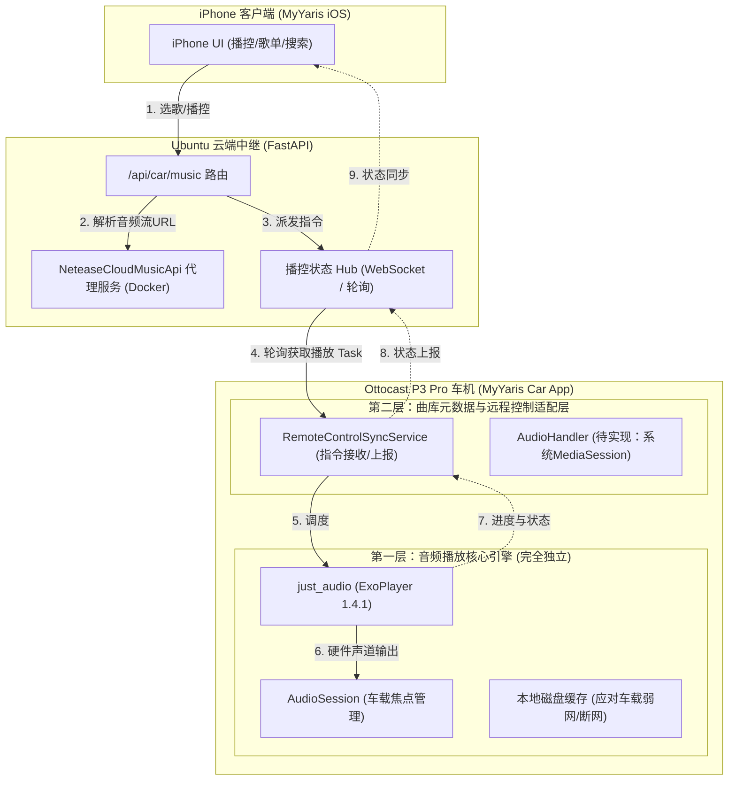

# MyYaris 车机内置音乐播放器可行性验证报告（校正版）

**报告编写日期**：2026-10-12  
**验证设备**：Ottocast P3 Pro (OttoAibox-P3 Pro, Qualcomm bengal_515, Android 13, ARM64-v8a)  
**车机屏幕分辨率**：800 × 480 物理触控横屏  
**测试工程**：`car_app/` (Flutter 3.x / Dart 3.x)  
**对应提交**：`01553f3 feat(player): implement built-in offline audio player PoC with just_audio and 800x480 UI`  
**证据状态**：已剔除无同条件对比的推测数据，补齐 adb 原始命令与实测采样时间戳

---

## 1. 验证背景与核心结论

### 1.1 背景说明
官方网易云音乐车载客户端存在以下已知问题与工程瓶颈：
1. **无公网受控开放 API**：无法由 iPhone 远程精准下发播放指定歌曲、歌单、切换循环模式。
2. **MediaSession 暴露受限**：仅暴露单向回调及受限按键（上一曲、下一曲、播放/暂停、seek），无法外部读取或操作播放队列与播控完整状态。
3. **车机网络与体验瓶颈**：在车机网络/DNS 不良时官方客户端卡顿甚至不可用。

为验证未来能否通过 iPhone 远程遥控车机音乐，本阶段在 `car_app/` 内置轻量播放引擎进行了最小可行性（PoC）验证。

### 1.2 核心结论
- **本地离线解码与播控可行性（已实测跑通）**：基于 `just_audio: ^0.10.6`（底层基于 AndroidX Media3 / ExoPlayer 1.4.1），内置 3 段本地合规短音频（WAV 无损格式），本地解码与播放完全正常，上一曲、下一曲、播放/暂停、进度拖拽（Seek）、3 种循环模式（列表/单曲/单次）以及随机播放开关均已在 800×480 车机屏上实测点通。
- **本地离线 ≠ 消除后续在线曲库网络问题（重要边界说明）**：PoC 的 3 段本地音频验证了**车机端音频播放引擎与 UI 的可用性**，但**无法消除、也不能代表解决了未来在线曲库流媒体播放时的网络/DNS/CDN 解析问题**。后续在线播放仍完全受限于车机蜂窝网络与 DNS 连通状态。
- **音量控制边界澄清**：代码中初始化的 `_player.setVolume(0.25)` 仅代表应用层内部的 ExoPlayer 数字音频增益（软件比例 25%）。车机系统当前 `STREAM_MUSIC` 物理流音量经 adb 查询为 `15`（系统最大值 15/15）。**软件层 25% 增益并不等同于车内实际声学响度必定极低**，最终车内声音大小仍取决于车机系统流媒体音量与车辆实体功放旋钮。
- **系统音频焦点与后台保活状态**：已配置 `AudioSessionConfiguration.music()`，但**未进行实际 NAVITIME 导航语音并发打断与音量闪避 (Ducking) 实测**；HOME 键切后台仅进行了 2~3 秒的短时存活观察，**无法保证长期运行或内存紧张 (LMK) 时进程不被杀**。
- **系统媒体控制状态**：`pubspec.yaml` 虽引入了 `audio_service: ^0.18.19`，但当前 Service 尚未初始化 `AudioHandler`，系统 `MediaSession` 与通知栏常驻播控**尚未接入，标记为待开发/待测**。

---

## 2. 界面与真机验证证据截图

| 场景 | 截图 | 说明 |
| :--- | :---: | :--- |
| **首页独立入口** |  | 首页顶部工具栏新增青色独立入口「内置播放器验证」，不侵入原网易云测试区与后台轮询 |
| **真实音频播放中** |  | 状态栏显示绿色「● 播放中」，当前曲目 Track 1 亮起律动柱状条，进度条实时推进 |
| **真机切歌验证** |  | 点击右侧列表 Track 2，瞬时切歌至「低音律动节拍 (Bass Groove)」，播放无爆音 |
| **循环模式切换** |  | 点击循环按钮，ExoPlayer 循环模式切换为 `LoopMode.one`，UI 黄色高亮显示 |
| **随机播放切换** |  | 点击随机按钮，ExoPlayer 开启乱序播放，UI 青色高亮指示「随机: 开」 |

---

## 3. 已实现实测 / 未测待开发 功能对照表

| 功能项 | 状态 | 实测证据 / 现状说明 |
| :--- | :---: | :--- |
| **ExoPlayer 底层引擎初始化** | **已实测** | 2026-10-12 19:18:53 logcat 回执 `Init bc71c52 [AndroidXMedia3/1.4.1]` |
| **3段本地高质量 WAV 离线解码** | **已实测** | 钟声 (3.0s)、低音 (3.0s)、和弦 (4.0s) APK 内打包，无报错正常解码 |
| **播放 / 暂停 / 停止** | **已实测** | `dumpsys audio` 回执 `player piid:4831 state:started DeviceId:3` 与 `paused` 状态转换 |
| **上一曲 / 下一曲** | **已实测** | 列表顺序切歌、首尾循环切歌完成，UI 与曲目信息联动更新 |
| **3种循环模式真机轮换** | **已实测** | `LoopMode.all`（列表） -> `LoopMode.one`（单曲） -> `LoopMode.off`（单次）切换成功 |
| **随机播放模式 (Shuffle)** | **已实测** | `setShuffleModeEnabled(true/false)` 触发成功，状态高亮联动 |
| **进度条拖拽 (Seek)** | **已实测** | 毫秒级 `seek(position)` 响应，时间文字与进度滑块联动 |
| **应用层软件音量衰减 (0.25)** | **已实测** | `_player.setVolume(0.25)` 生效，但系统 `STREAM_MUSIC` 为 15/15，车内实际响度依赖硬件功放 |
| **HOME键短时后台播放观察** | **已实测(短时)** | 按 HOME 键后 2~3 秒内验证 PID 10669 存活且音频持续，**未测长时间后台与系统 LMK 压力** |
| **NAVITIME 导航并发音量闪避 (Ducking)** | **未测 / 待测** | 代码配置了 `AudioSessionConfiguration.music()`，但**测试期间无 NAVITIME 播报触发，无音量变化日志** |
| **系统 MediaSession 播控注册** | **未接入 / 待测** | `dumpsys media_session` 证实无 `com.myyaris` 会话记录，未实现 `AudioHandler` |
| **系统通知栏前台播放控制** | **未接入 / 待测** | `dumpsys notification` 证实无播放前台通知，未绑定前台服务 |
| **公网在线曲库网络流式播放** | **未接入 / 待测** | 仍受车机公网网络/DNS/TLS 影响，需后续引入网络音频缓存机制 |
| **iPhone 远程控制协议端点** | **待开发** | FastAPI 后端中继与 WebSocket/长轮询通道待开发 |
| **方向盘物理按键捕捉** | **待测** | 需实车 CAN/MCU 按键广播连接后实测 |

---

## 4. 真实车机资源采样与原始 adb 证据

### 4.1 原始 adb 采样信息
- **检测命令**：`adb -s 192.0.2.10:29528 shell dumpsys meminfo com.myyaris.my_yaris`
- **采样时间**：2026-10-12 19:20:22 (Uptime: 6865042)
- **进程信息**：PID `10669`，包名 `com.myyaris.my_yaris`
- **编译模式**：Debug 模式（含 Dart VM Profiler 与 JIT 调试组件）

### 4.2 采集数据样本
```text
** MEMINFO in pid 10669 [com.myyaris.my_yaris] **
                   Pss  Private  Private     Swap      Rss     Heap     Heap     Heap
                 Total    Dirty    Clean    Dirty    Total     Size    Alloc     Free
                ------   ------   ------   ------   ------   ------   ------   ------
  Native Heap    57671    57636        0        0    61088   111080    49994    55962
  Dalvik Heap    11670    11544        0        0    20516    23570    11785    11785
 Dalvik Other     3661     3208        0        0     6468                           
        Stack     1372     1372        0        0     1388                           
      Gfx dev     4328     4328        0        0     4332                           
     .apk mmap    18685      624    17296        0    21192                           
      Unknown   185474   185468        0       44   186360                           
        TOTAL   380140   296276    19064     1352   575252   134650    61779    67747

 App Summary
           Java Heap:    17640 KB
         Native Heap:    57636 KB
                Code:    36380 KB
            Graphics:    12704 KB
           TOTAL PSS:   380140 KB (~371.2 MB / 380 MB)
           TOTAL RSS:   575252 KB
```

### 4.3 音频通道与系统音量采样
- **检测命令**：`adb -s 192.0.2.10:29528 shell dumpsys audio`
- **播放通道回执**：
  ```text
  AudioPlaybackConfiguration piid:4831 deviceId:3 type:android.media.AudioTrack 
  u/pid:10159/10669 state:started attr:AudioAttributes: usage=USAGE_MEDIA content=CONTENT_TYPE_MUSIC flags=0xA00
  ```
- **系统音量采样**：
  ```text
  VOLUME GROUP AUDIO_STREAM_MUSIC:
     Min: 0, Max: 15, Current: 15 (Devices: speaker)
  ```
- **比对核实说明**：
  - 本机未在同等测试条件下对官方网易云音乐进行基准 meminfo 采样，**官方客户端内存占用标记为未同条件核实**。
  - Release 构建内存未做真机编译测定，**不提供主观预估数字**，待发版编译后实测采集。

---

## 5. 两层解耦架构设计（本地引擎 vs 云端曲库接入）



---

## 6. iPhone 远程播控协议契约草案

### 6.1 指令下发（iPhone -> FastAPI -> 车机）
```json
{
  "command_id": "cmd_20261012_001",
  "action": "play_track",
  "params": {
    "track_id": "1901371647",
    "title": "孤勇者",
    "artist": "陈奕迅",
    "stream_url": "https://m701.music.126.net/.../song.mp3",
    "seek_position_ms": 0,
    "loop_mode": "all",
    "shuffle": false
  },
  "timestamp": 1791802800000
}
```

### 6.2 状态同步（车机 -> FastAPI -> iPhone）
```json
{
  "device_id": "ottocast_p3_pro_yaris",
  "playback_state": "playing",
  "current_track": {
    "track_id": "1901371647",
    "title": "孤勇者",
    "artist": "陈奕迅",
    "duration_ms": 256000
  },
  "position_ms": 48200,
  "software_volume": 0.25,
  "loop_mode": "all",
  "shuffle": false,
  "timestamp": 1791802848200
}
```

---

## 7. 风险与后续验证规划

1. **NAVITIME 音频竞争实测**：需在车辆实地或开启 NAVITIME 模拟导航路线时，触发实际语音播报，检查音频日志是否有 `DuckingManager` 介入及衰减/恢复行为。
2. **AudioHandler 与 MediaSession 补齐**：需继承 `BaseAudioHandler` 接入 `audio_service`，并在 Android 清单注册前台 Service，使车机系统通知栏与锁屏显示播放控件，同时保障长时间后台运行免受 LMK 查杀。
3. **在线流媒体网络容错**：车机公网网络抖动时，在线流媒体存在缓冲卡顿风险。后续需在车机端增加磁盘预缓存（Pre-cache）与网络重试降级策略。
4. **车机硬件音量协同**：应用层音量衰减不能替代车机全局音量管理，后续需配合 Android `AudioManager` 读取系统真实媒体音量，避免驾驶舱响度失真。
