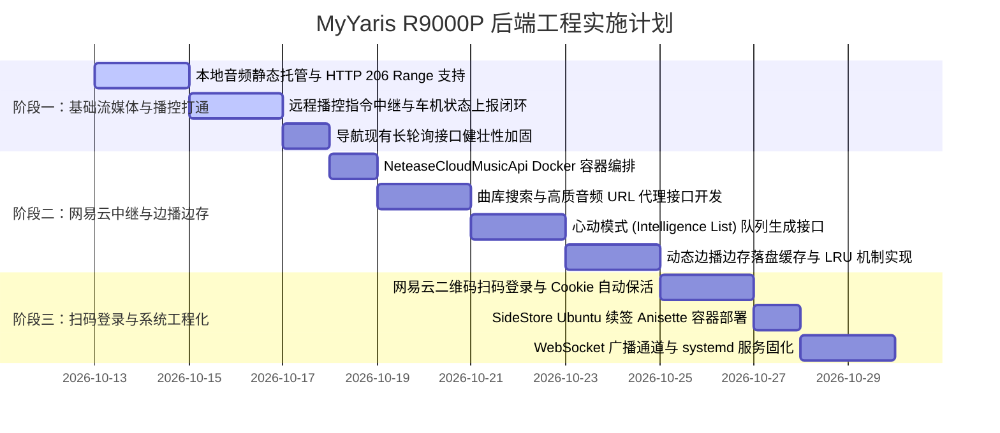

# MyYaris 后端需求全景与系统设计规范 (V2.0)

**文档版本**：V2.0
**编制日期**：2026-10-12
**部署宿主机**：联想拯救者 R9000P (Ubuntu Linux)
**网络拓扑**：Tailscale Mesh 虚拟局域网（车机 `192.0.2.10`、iPhone、R9000P 组网）
**技术栈**：Python 3.11+ / FastAPI / SQLite (WAL模式) / Docker
**关联前端**：`car_app/` (Ottocast P3 Pro 车机) 与 `ios_app/` (iPhone 客户端)

---

## 1. 总体目标与系统定位

后端（部署于 R9000P）是连接 **iPhone 移动端** 与 **Ottocast P3 Pro 车机端** 的核心大脑与应用层中继网关（Hub），承担以下三大业务支柱：

```text
 ┌───────────────────────┐                    ┌─────────────────────────┐
 │ iPhone 客户端 (iOS)   │                    │ 车机客户端 (Car App)   │
 │ - 目的地搜索/分享     │                    │ - 接收并拉起 NAVITIME   │
 │ - 音乐选歌/心动模式   │                    │ - 本地音频播放与播控    │
 │ - 远程查看车机状态    │                    │ - 上报播放与导航状态    │
 └───────────┬───────────┘                    └────────────▲────────────┘
             │                                             │
             │           Tailscale Mesh 私有网络           │
             └─────────────────────┬───────────────────────┘
                                   │
                     ┌─────────────▼─────────────┐
                     │ R9000P 后端全功能中继服务 │
                     │  (FastAPI + 本地媒体库)   │
                     └─────────────┬─────────────┘
                                   │
              ┌────────────────────┴────────────────────┐
              ▼                                         ▼
   ┌──────────────────────┐                  ┌──────────────────────┐
   │ 第三方地图 / 语音服务│                  │ 网易云音乐官方云端   │
   │ (Google Maps / LLM)  │                  │ (住宅IP代理 / 逆向)  │
   └──────────────────────┘                  └──────────────────────┘
```

1. **智能导航与任务分发**：接收来自 iPhone 或车机语音的地点输入，解析标准化坐标，经由可靠长轮询/WebSocket 派发给车机，闭环记录 CAR NAVITIME 打开回执。
2. **私有流媒体与网易云代理网关**：托管本地无损/MP3 媒体库，提供 HTTP 206 断点分段音频流；代理网易云新歌搜索、心动模式生成及音频高质流解析，执行“边播边存”动态缓存。
3. **iPhone 远程播控与状态双向同步**：统一抽象播控指令契约（播放/暂停/切歌/循环模式/进度 Seek），实现 iPhone 远程调度车机、车机毫秒级状态实时回传。

---

## 2. 待开发需求模块全景

### 模块一：智能导航与目的地流转模块（成熟完善）

| 编号 | 需求项 | 详细描述 | 优先级 |
| :--- | :--- | :--- | :---: |
| **NAV-01** | **Google Maps 短链与外部地址解析** | 解析 `maps.app.goo.gl` 302 重定向真实 URL，提取目标经纬度；支持普通文本地址由 Nominatim / 地图 API 转换为 WGS84 坐标。 | P0 |
| **NAV-02** | **车机目的地任务队列与长轮询派发** | 支持生成结构化任务（`task_id`、坐标、名称、时效）。车机通过 `/api/v1/tasks/poll` 保持长轮询或 WebSocket 实时接收。 | P0 |
| **NAV-03** | **任务生命周期与 CAR NAVITIME 确认回执** | 车机拉起导航后上报回执（`acknowledged` / `failed`），记录 `received_at`、`launched_at` 时间戳；超时未消费任务自动置为 `expired`。 | P0 |
| **NAV-04** | **语音识别与目的地实体抽取 (可选扩展)** | 接收车机录制的短语音片段，经由 Whisper / 语音服务转写，并调用 LLM 提取明确的地点意图，生成确认候选列表。 | P2 |

---

### 模块二：私有音频库与流媒体服务模块（新增核心）

| 编号 | 需求项 | 详细描述 | 优先级 |
| :--- | :--- | :--- | :---: |
| **MED-01** | **本地自有音乐存储与元数据索引** | 在 R9000P 磁盘建立 `/data/media/local_tracks/` 目录，扫描 MP3/FLAC/WAV 文件并解析 ID3 标签（标题、歌手、专辑、时长），存入 SQLite 媒体库。 | P0 |
| **MED-02** | **HTTP 206 Partial Content 流式传输** | 提供标准静态流媒体端点 `/api/v1/music/stream/{track_id}`，完整实现 HTTP `Range: bytes=start-end` 请求，支持车机 ExoPlayer 毫秒级拖拽快进无爆音。 | P0 |
| **MED-03** | **动态“边播边存”缓存池管理** | 建立 `/data/media/cache/` 目录；当点播未缓存的在线网易云歌曲时，后端流式代理传输至车机的同时异步写入本地文件；下次点播直接命中本地文件，规避网易云 CDN 抖动与版权变动。 | P1 |
| **MED-04** | **缓存配额与淘汰机制 (LRU)** | 配置最大缓存容量（如 50GB），超过阈值时按最久未访问（Least Recently Used）自动淘汰旧音频缓存。 | P2 |

---

### 模块三：网易云上游代理与智能推荐模块（新增核心）

| 编号 | 需求项 | 详细描述 | 优先级 |
| :--- | :--- | :--- | :---: |
| **NET-01** | **NeteaseCloudMusicApi 容器化集成** | 在 R9000P 部署轻量化网易云开源逆向 Docker 服务（Binaryify API 或 Python 版 pyncm），配置本地端口 `127.0.0.1:3000` 供 FastAPI 内部调用。 | P0 |
| **NET-02** | **新歌与曲库综合搜索** | 提供 `/api/v1/music/netease/search` 接口，接收关键词、分页参数，向上游调用 `/cloudsearch`，返回清洗后的结构化歌曲列表（含歌曲ID、标题、艺术家、时长、专辑封面）。 | P0 |
| **NET-03** | **心动模式（智能推荐）队列生成** | 提供 `/api/v1/music/netease/intelligence` 接口，入参当前播放歌曲 `song_id` 与用户收藏歌单 `playlist_id`，调用上游 `/playmode/intelligence/list`，返回无限推荐歌曲队列。 | P0 |
| **NET-04** | **高质音频流 URL 解析** | 提供 `/api/v1/music/netease/song_url` 接口，入参 `song_id` 与音质级别（`exhigh` 320k / `lossless` 无损），提取网易云 CDN 真实直链，供本地中继或缓存抓取。 | P0 |
| **NET-05** | **扫码登录与 Cookie 安全保管** | 实现二维码生成 (`/login/qr/key` & `/login/qr/create`) 与轮询检测 (`/login/qr/check`)，用户通过 iPhone 网易云扫码授权，Cookie 加密保存在 R9000P 磁盘，定期自动续签保活。 | P1 |
| **NET-06** | **歌词与封面图聚合输出** | 提供 `/api/v1/music/netease/lyric` 接口，返回标准化 LRC 歌词与封面高清 CDN 图，供 iPhone 与车机前端展示。 | P2 |

---

### 模块四：iPhone 远程播控与状态双向同步模块（新增核心）

| 编号 | 需求项 | 详细描述 | 优先级 |
| :--- | :--- | :--- | :---: |
| **CTL-01** | **远程播控指令路由 (iPhone -> 车机)** | 接收来自 iPhone 的播控操作（播放、暂停、下一曲、上一曲、进度 Seek、三种循环模式、随机开关），封装为即时指令下发给车机。 | P0 |
| **CTL-02** | **车机实时播放状态上报与存储** | 车机定期（或在状态变化时）上报当前播放进度（毫秒）、当前曲目ID、播放状态（playing/paused/stopped）、音量比例、真实循环模式。 | P0 |
| **CTL-03** | **状态广播与长连接分发 (WebSocket)** | 建立 `/api/v1/ws/music` 全双工通道，车机上报状态后，秒级向在线的 iPhone 客户端广播，实现手机端进度条与按键状态的实时跟随。 | P1 |

---

### 模块五：系统运维、鉴权与辅助模块

| 编号 | 需求项 | 详细描述 | 优先级 |
| :--- | :--- | :--- | :---: |
| **OPS-01** | **Tailscale 节点鉴权与 API Token** | 基于 HTTP Header `X-Device-Token` 或 `Authorization: Bearer <token>` 进行身份验证，仅允许车机与绑定的 iPhone 访问核心接口。 | P0 |
| **OPS-02** | **systemd 服务守护与开机自启** | 编写 `myyaris-backend.service`，在 R9000P 启动时自动运行，包含故障自动拉起与标准日志滚动。 | P0 |
| **OPS-03** | **SideStore 自动续签配套容器支持** | 部署 `docker run ... anisette-v3` 容器，配合本地 WireGuard/Tailscale 环境，为 iPhone 端 `ios_app/` 提供 7 天免连电脑自动重签名支持。 | P1 |
| **OPS-04** | **SQLite 数据库迁移与自动定期备份** | 针对导航任务表、本地媒体表、播放状态表设计 Alembic 迁移脚本，每日定时将 SQLite 库备份至备份目录。 | P2 |

---

## 3. 核心 API 接口契约规范

### 3.1 导航任务接口

#### `POST /api/v1/destinations/resolve`
- **说明**：iPhone 或车机提交原始文本或 Google Maps 链接，后端解析经纬度。
- **请求体**：
  ```json
  {
    "raw_input": "https://maps.app.goo.gl/EXAMPLE",
    "source": "ios_share" // "ios_share" | "car_ui" | "voice"
  }
  ```
- **返回体**：
  ```json
  {
    "code": 200,
    "destination_id": "dest_20261012_001",
    "name": "秋叶原电车站",
    "latitude": 35.698383,
    "longitude": 139.773072,
    "confidence": 0.98
  }
  ```

#### `POST /api/v1/tasks/destination`
- **说明**：将已确认的地点正式入库并生成待执行的导航任务。
- **请求体**：
  ```json
  {
    "destination_id": "dest_20261012_001",
    "expires_in_seconds": 3600
  }
  ```

#### `GET /api/v1/tasks/poll?device_id=ottocast_p3_pro`
- **说明**：车机长轮询端点，挂起等待新导航或音乐指令（超时返回 204）。

#### `POST /api/v1/tasks/{task_id}/ack`
- **说明**：车机上报已接收或已拉起 CAR NAVITIME。
- **请求体**：
  ```json
  {
    "status": "launched", // "received" | "launched" | "failed"
    "client_timestamp": 1791802900000,
    "error_message": null
  }
  ```

---

### 3.2 音乐与流媒体接口

#### `GET /api/v1/music/stream/{track_id}`
- **说明**：音频分段流式输出接口，支持 `Range: bytes=0-1048576` 请求。
- **响应头**：
  ```http
  HTTP/1.1 206 Partial Content
  Content-Type: audio/mpeg
  Accept-Ranges: bytes
  Content-Range: bytes 0-1048575/9823420
  Content-Length: 1048576
  ```

#### `GET /api/v1/music/netease/search?keyword={kw}&page=1&limit=20`
- **说明**：检索网易云曲库。
- **返回体**：
  ```json
  {
    "code": 200,
    "total": 120,
    "songs": [
      {
        "id": 1901371647,
        "title": "孤勇者",
        "artist": "陈奕迅",
        "album": "孤勇者",
        "duration_ms": 256000,
        "cover_url": "https://p1.music.126.net/..."
      }
    ]
  }
  ```

#### `POST /api/v1/music/netease/intelligence`
- **说明**：生成心动模式播放队列。
- **请求体**：
  ```json
  {
    "seed_song_id": 1901371647,
    "playlist_id": 24381616,
    "count": 30
  }
  ```
- **返回体**：包含连续推荐的歌曲列表及流媒体解析直链。

---

### 3.3 远程播控与状态同步接口

#### `POST /api/v1/music/control/command`
- **说明**：iPhone 客户端向车机下发即时播控动作。
- **请求体**：
  ```json
  {
    "command_id": "cmd_music_1001",
    "action": "play_track", // play_track | pause | resume | next | prev | seek | set_loop | set_shuffle
    "params": {
      "track_id": "1901371647",
      "stream_url": "http://100.x.y.z:8000/api/v1/music/stream/1901371647",
      "title": "孤勇者",
      "artist": "陈奕迅",
      "seek_ms": 0,
      "loop_mode": "all", // all | one | off
      "shuffle": false
    }
  }
  ```

#### `POST /api/v1/music/control/status`
- **说明**：车机向后端心跳上报当前真实播放器状态。
- **请求体**：
  ```json
  {
    "device_id": "ottocast_p3_pro",
    "playback_state": "playing", // playing | paused | stopped
    "current_track_id": "1901371647",
    "position_ms": 48200,
    "duration_ms": 256000,
    "software_volume": 0.25,
    "loop_mode": "all",
    "shuffle": false,
    "updated_at": 1791802950000
  }
  ```

---

## 4. 数据库设计草案 (SQLite)

```sql
-- 1. 目的地与导航任务表 (现有扩展)
CREATE TABLE destination_tasks (
    id TEXT PRIMARY KEY,
    source TEXT NOT NULL,
    title TEXT NOT NULL,
    latitude REAL NOT NULL,
    longitude REAL NOT NULL,
    status TEXT NOT NULL DEFAULT 'pending', -- pending, sent, launched, failed, expired
    created_at INTEGER NOT NULL,
    expires_at INTEGER NOT NULL,
    received_at INTEGER,
    launched_at INTEGER,
    error_message TEXT
);

-- 2. 媒体库元数据表 (本地音乐 + 缓存音乐)
CREATE TABLE media_tracks (
    track_id TEXT PRIMARY KEY,
    source TEXT NOT NULL, -- 'local_repo' | 'netease_cache'
    title TEXT NOT NULL,
    artist TEXT NOT NULL,
    album TEXT,
    duration_ms INTEGER NOT NULL,
    file_path TEXT NOT NULL,
    file_size_bytes INTEGER NOT NULL,
    bitrate_kbps INTEGER,
    cover_url TEXT,
    hit_count INTEGER DEFAULT 0,
    last_accessed_at INTEGER NOT NULL,
    created_at INTEGER NOT NULL
);

-- 3. 车机实时状态快照表 (最新一条)
CREATE TABLE car_device_status (
    device_id TEXT PRIMARY KEY,
    playback_state TEXT NOT NULL,
    current_track_id TEXT,
    position_ms INTEGER NOT NULL,
    software_volume REAL NOT NULL,
    loop_mode TEXT NOT NULL,
    shuffle_enabled INTEGER NOT NULL,
    last_heartbeat_at INTEGER NOT NULL
);
```

---

## 5. 实施里程碑与排期建议



- **第一阶段（预计 3~5 天）**：打通 R9000P 本地 MP3 静态流媒体托管，车机端 `car_app` 能通过 Tailscale 播放 R9000P 上的音频，实现 iPhone 远程播控基本闭环。
- **第二阶段（预计 5~7 天）**：部署网易云 Docker 代理，实现搜索、心动模式与动态音频落盘缓存。
- **第三阶段（预计 3~5 天）**：完善扫码登录、SideStore 容器部署与 systemd 自动化守护。
