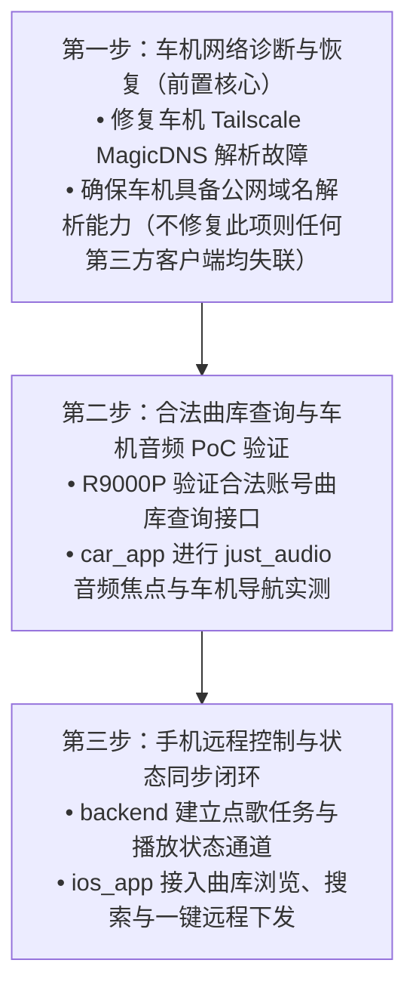

# 网易云第三方 API 与轻量客户端技术调研报告（修订版）

- **调研日期**：2026-10-12
- **调研执行**：Flutter / Android 车机工程研发
- **目标场景**：丰田 Yaris 车机（Ottocast P3 Pro / Android 13 arm64 / 800×480）与 iPhone 移动端远程播控联动
- **工作区上下文**：
  - `car_app/`：Flutter 车机工程
  - `ios_app/`：Flutter iPhone 客户端（UI 构建中）
  - `backend/`：FastAPI + SQLite（部署于 Ubuntu R9000P 局域网服务器）
  - `docs/`：设计规范与技术调研

---

## 声明：前期报告不严谨结论之正式撤回与修正

经进一步核查源代码、官方仓库状态及真实运行环境，对上一版本调研报告中缺乏实测依据或表述绝对化的结论进行正式撤回与校正：

1. **撤回“Binaryify/NeteaseCloudMusicApi 官方稳定维护”的断言**：
   - **事实**：该 GitHub 仓库已于 **2024-04-16 被原作者正式归档（Archived / Read-only）**，README 明确写明因版权保护原因不再维护。
   - **校正**：NPM 上的同名包属于第三方历史包，非网易云官方发布，且缺乏经实证的持续代码溯源；不能将历史高知名度或历史 NPM 发版等同于当前官方稳定维护。
2. **撤回所有未经实测的具体内存数据与绝对化性能承诺**：
   - 撤回“内存占用 < 30MB”、“内存 80-120MB”、“官方网易云 400-900MB”、“彻底解决卡顿”等推论；
   - **校正**：在车机硬件上未进行真实 `dumpsys meminfo` 压测前，一切具体数值均标为“未实测”；卡顿改善程度取决于实际 Webview/Flutter/原生渲染负载，不作绝对承诺。
3. **撤回“所有非 VIP 歌曲一律仅试听 / 方案必须强制使用 VIP Cookie”的断言**：
   - **事实**：网易云曲库根据版权协议划分等级。海量普通免费公有曲目、非 VIP 曲目在标准码率下无需 VIP 即可正常完整获取播放链接；
   - **校正**：能否播放需按**具体单曲版权属性、用户账号权限（普通/黑胶）、以及 IP 地理区域限制**精细区分，不可一概而论。
4. **撤回“所有第三方 YesPlayMusic 打包均为山寨危险”的泛化定性**：
   - **事实**：YesPlayMusic 官方仓库明确仅提供 macOS、Windows、Linux 及 Web 端，**官方从未发布 Android 客户端**；
   - **校正**：社区存在的移动端 APK 仅能定性为“非官方社区二次移植或套壳”，其签名、更新链与安全性属于“未经官方背书与核实”，不宜无证据直接定性为恶意山寨。
5. **撤回“自研播放器能保证完整支持方向盘按键与导航自动 Ducking”的保证**：
   - **校正**：这是架构设计建议。虽然 `just_audio` + `audio_service` 在标准 Android 上支持 `MediaSession` 与 `AudioFocusRequest`，但在 Ottocast P3 Pro 特殊原厂协议与车载 MCU 映射下，方向盘物理按键捕获与 NAVITIME 语音中断压低依然需要进行真实的软硬件联调适配测试，不能预先保证。
6. **校正车机 DNS 诊断范围说明**：
   - **校正**：此前 DNS 诊断仅为 **2026-10-12 18:05 ADB 检测时间窗口的车机系统网络状态切片**（Tailscale MagicDNS `192.0.2.10:53` 超时），并非本轮针对各个第三方客户端的实机运行实测。

---

## 一、 核心前置概念与运行机制分析

### 1. 曲库数据 API ≠ 官方 App 远程控制接口
- **外部 API 的定位**：封装网易云网络请求，用于查询元数据或取得音频流直链，**无法向车机上现有的网易云官方 App 注入指令**。
- **调用形式区分**：不同开源项目的形态各异，必须严格区分：
  - **纯代码库 (Library / SDK)**：仅提供语言级函数（如 Go package、Rust crate、Python module），自身不自带 HTTP 监听服务，必须二次开发编写服务端；
  - **命令行工具 (CLI)**：用于终端交互或单次任务脚本；
  - **独立 HTTP 服务 / Docker 容器**：自带 Web 框架（如 Express/FastAPI），可直接暴露 HTTP REST 接口供外部调用。

### 2. 第三方客户端的音源机制：账号云库 vs 替代源 (Alternative Sources)
在调研第三方播放器（如 MusicFree、LX Music）时，必须明确区分音频从何而来：
- **原生账号云库播放**：客户端使用用户自身的网易云账号凭据登录，直接从网易云官方 CDN 拉取用户收藏歌单的真实音频流；
- **插件/脚本替代源 (Fallback / Scraped Sources)**：部分第三方客户端属于“空壳播放器”，其扩展插件或自定义脚本可能通过关键词在第三方搜索引擎、其它音乐平台或抓取镜像中检索同名替代音源。**此类播放不属于网易云官方曲库流，音质、版本（现场版/翻唱）及稳定性不可控，严禁混为一谈**。

### 3. 曲库可播放性分类细则（合法账户范围内）
| 歌曲版权类型 | 未登录 / 游客 | 普通免费账号 | 黑胶 VIP 账号 | 说明 |
| :--- | :--- | :--- | :--- | :--- |
| **完全免费公有曲目** | 可完整播放（标准音质） | 可完整播放（标准/较高音质） | 可完整播放（无损/高音质） | 官方开放 CDN 播放 |
| **VIP 专享曲目** | 仅 30 秒试听片段或报错 | 仅 30 秒试听片段 | 完整播放（带鉴权 Token） | 需官方接口验证黑胶 Cookie |
| **付费数字专辑曲目** | 无法播放 | 仅在单买专辑后可播放 | 仅在单买专辑后可播放 | 需订单购买记录 |
| **无版权 / 灰色下架曲目** | 无法播放 (`url: null`) | 无法播放 (`url: null`) | 无法播放 (`url: null`) | 除非用户云盘自行上传备份 |
| **海外地域限制曲目** | 无法播放 / 404 | 无法播放 / 404 | 无法播放 / 404 | 严格受 IP 出口地域限制 |

---

## 二、 重点项目技术指标与证据核实（8 个项目）

### （一） 方向一：Ubuntu R9000P 可部署的曲库 API

#### 1. Binaryify/NeteaseCloudMusicApi
* **官方仓库链接**：[https://github.com/Binaryify/NeteaseCloudMusicApi](https://github.com/Binaryify/NeteaseCloudMusicApi)
* **许可证**：MIT License（仓库根目录 `LICENSE`）
* **归档状态与原文依据**：**已归档（Archived / Read-only）**。GitHub 明确标注归档时间为 **2024-04-16**，README 说明因版权保护停止维护。
* **最新 Release / Commit 依据**：
  - 仓库最终 Commit 时间：2024-04-16（归档前最后提交）；
  - 最终 GitHub Release：`v4.14.0`（2024-01-28，[Releases 页面](https://github.com/Binaryify/NeteaseCloudMusicApi/releases)）。
* **服务形态**：原生为 Node.js / Express 编写的 **HTTP 服务**，提供官方 Docker 镜像（`binaryify/netease_cloud_music_api`）。
* **维护与风险评估**：虽然 NPM 上存在历史包 `NeteaseCloudMusicApi`，但因上游 GitHub 已归档，该包无持续官方维护背书。社区衍生的各 Fork 版本（如 Serverless 版）代码审计难度大，存在潜在凭据泄露风险。

#### 2. go-musicfox/netease-music
* **官方仓库链接**：[https://github.com/go-musicfox/netease-music](https://github.com/go-musicfox/netease-music)
* **许可证**：MIT License（仓库根目录 `LICENSE`）
* **归档状态**：**活跃维护（未归档）**。
* **最新 Release / Commit 依据**：
  - 最近 Commit：约 5 个月前（commit `feat: 支持设置unm代理` by anhoder，`master` 分支，[Commits 记录](https://github.com/go-musicfox/netease-music/commits/master)）；
  - Tags：累计发布 38 个版本 Tag。
* **服务形态**：**纯 Go 语言库 (Library / SDK)**。**不自带 HTTP 监听服务**，若需在 Ubuntu R9000P 供 Python/外部调用，必须编写 Go 包装代码暴露 HTTP 接口。
* **内存占用**：未实测（Go 二进制常驻通常内存较低，但具体视请求缓冲而定）。

#### 3. chaunsin/netease-cloud-music
* **官方仓库链接**：[https://github.com/chaunsin/netease-cloud-music](https://github.com/chaunsin/netease-cloud-music)
* **许可证**：MIT License（仓库根目录 `LICENSE`）
* **归档状态**：**活跃维护（未归档）**。
* **最新 Release / Commit 依据**：
  - 最近 Release：`v0.8.1`（2026-09 发布，[Releases 页面](https://github.com/chaunsin/netease-cloud-music/releases)）；
  - 最近 Commit：2026 年 9-10 月持续活跃。
* **服务形态**：**Go 命令行工具 (`ncmctl`) + Go SDK 库**。提供 Makefile 编译和 Docker 运行支持，包含 API 请求调试逻辑，但主要面向 CLI 和任务调度，非开箱即用的通用 REST 服务端。

#### 4. gmg137/netease-cloud-music-api
* **官方仓库链接**：[https://github.com/gmg137/netease-cloud-music-api](https://github.com/gmg137/netease-cloud-music-api)
* **许可证**：GPL-3.0（仓库源码与 `netease-cloud-music-gtk` 衍生说明）
* **归档状态**：**活跃维护（未归档）**。
* **最新 Release / Commit 依据**：
  - 最近 Commit：2025–2026 年（版本同步至 `v2.2.x`，[Commits 记录](https://github.com/gmg137/netease-cloud-music-api/commits/master)）。
* **服务形态**：**纯 Rust 库 (Rust Crate / Library)**。**不自带独立 HTTP 服务或 Docker**，必须在 Rust 代码中通过 `Cargo.toml` 依赖引入。

---

### （二） 方向二：Ottocast P3 Pro (Android 13 arm64) 轻量第三方播放器

#### 5. maotoumao/MusicFree
* **官方仓库链接**：[https://github.com/maotoumao/MusicFree](https://github.com/maotoumao/MusicFree)
* **许可证**：GNU Affero General Public License v3.0 (AGPL-3.0)
* **归档状态**：**活跃维护（未归档）**。
* **最新 Release 依据**：
  - 最新正式测试版：`v1.0.0-beta.3`（发布日期：2026-06-19，[Releases 页面](https://github.com/maotoumao/MusicFree/releases)）；
  - 提供兼容 `arm64-v8a` 的标准 Release APK。
* **音源与核心机制**：
  - **本体无音源**：软件自身纯粹为播放器前端，无网易云内置代码；
  - **插件依赖**：所有歌曲检索与播放均依赖用户导入的第三方 JavaScript 插件。插件可能从网易云直接解析，也可能调用第三方替代源，**无法保证纯净与网易云官方账号状态完全一致**。
* **车载与远控能力核验**：
  - **横屏支持**：UI 具备响应式横屏布局，但在 800×480 车机窄矮屏下的触控交互体验**待测**；
  - **MediaSession**：具备原生 Android `MediaSession` 支持；
  - **远程控制**：**无对外 HTTP 远程控制接口**；
  - **内存消耗**：未实测。

#### 6. lyswhut/lx-music-mobile
* **官方仓库链接**：[https://github.com/lyswhut/lx-music-mobile](https://github.com/lyswhut/lx-music-mobile)
* **许可证**：Apache License 2.0（附带特定开源数据补充条款）
* **归档状态**：**活跃维护（未归档）**。
* **最新 Release 依据**：
  - 最新版本：`v1.9.1`（发布日期：2026-09，[Releases 页面](https://github.com/lyswhut/lx-music-mobile/releases)）；
  - 官方提供 `arm64-v8a` 独立架构 APK。
* **音源与核心机制**：
  - 自 v1.0 起官方已移除所有内置换源代码；
  - 必须依赖外部“自定义源脚本（User Script）”。**音频通常来自爬取解析或替代源平台，并非直接登录用户网易云账号进行合法鉴权云播放**。
* **车载与远控能力核验**：
  - **横屏支持**：支持系统自动旋转横屏；
  - **MediaSession**：具备原生 Foreground Service 与 `MediaSession`；
  - **远程控制**：**无自带移动端 HTTP 远控 API**；
  - **内存消耗**：未实测（基于 React Native 框架，需实机验证运行时开销）。

#### 7. wangchenyan/ponymusic (波尼音乐)
* **官方仓库链接**：[https://github.com/wangchenyan/ponymusic](https://github.com/wangchenyan/ponymusic)
* **许可证**：Apache License 2.0
* **归档状态**：**活跃维护（未归档）**。
* **最新 Release 依据**：
  - 最新版本：`v2.4.0-beta01`（发布日期：2025-10-30，[Releases 页面](https://github.com/wangchenyan/ponymusic/releases)）；
  - 提供官方构建的 APK。
* **音源与核心机制**：
  - 基于 Kotlin + Google Jetpack Media3 + ExoPlayer 构建；
  - **账号支持**：README 与源码明确包含网易云扫码登录与验证码登录模块，直接同步用户云端歌单；
* **车载与远控能力核验**：
  - **横屏支持**：主界面为手机竖屏黑胶唱片设计，800×480 车机横屏下的适配与按钮拉伸情况**待测**；
  - **MediaSession**：采用官方 `androidx.media3.session`，底层系统集成度高；
  - **远程控制**：**无对外暴露的 HTTP 远程切歌 API**；
  - **内存消耗**：未实测。

#### 8. qier222/YesPlayMusic (桌面端/Web——反向核验)
* **官方仓库链接**：[https://github.com/qier222/YesPlayMusic](https://github.com/qier222/YesPlayMusic)
* **许可证**：MIT License
* **归档状态**：**活跃维护（未归档）**。
* **最新 Release 依据**：
  - 最新版本：`v0.4.11`（发布日期：2026-10-10，[Releases 页面](https://github.com/qier222/YesPlayMusic/releases)）。
* **平台支持事实**：
  - 官方 Releases **仅提供 macOS (.dmg)、Windows (.exe) 和 Linux (.AppImage/.deb/.rpm) 桌面端包及 Docker 网页镜像**；
  - **官方明确没有 Android APK 发布物**；
  - 社区中流传的 Android 版本均为第三方个人打包（多为 WebView 套壳），其证书签名、网络传输与源码未经过官方审计，**不作可信推荐**。

---

## 三、 项目核心指标、服务类型与状态对照全景表

| 项目名称 | 官方 GitHub 仓库链接 | 软件类型 / 形态 | 许可证 | 维护状态依据 | 最新 Release / Commit 日期 | 车载横屏 / 触控适配 | 独立远程控制 API |
| :--- | :--- | :--- | :--- | :--- | :--- | :--- | :--- |
| **NeteaseCloudMusicApi** | [Binaryify/NeteaseCloudMusicApi](https://github.com/Binaryify/NeteaseCloudMusicApi) | HTTP 服务 / Docker | MIT | **已归档 (Archived)** | 2024-04-16 (commit) / v4.14.0 | 不适用 (后端) | 自带 HTTP REST 服务 |
| **netease-music** | [go-musicfox/netease-music](https://github.com/go-musicfox/netease-music) | 纯 Go 代码库 (Library) | MIT | 活跃维护 | 约 5 个月前 (commit) | 不适用 (底层库) | **无 HTTP 服务 (需自编包装)** |
| **netease-cloud-music** | [chaunsin/netease-cloud-music](https://github.com/chaunsin/netease-cloud-music) | Go CLI / SDK 库 | MIT | 活跃维护 | v0.8.1 (2026-09) | 不适用 (命令行) | CLI / 代理 (无标准播放控制 API) |
| **netease-cloud-music-api** | [gmg137/netease-cloud-music-api](https://github.com/gmg137/netease-cloud-music-api) | 纯 Rust 代码库 (Library) | GPL-3.0 | 活跃维护 | v2.2.x (2025–2026) | 不适用 (底层库) | **无 HTTP 服务 (需自编包装)** |
| **MusicFree** | [maotoumao/MusicFree](https://github.com/maotoumao/MusicFree) | Android 原生 App | AGPL-3.0 | 活跃维护 | v1.0.0-beta.3 (2026-06-19) | 响应式横屏 (800×480体验**待测**) | **无对外 HTTP 远程控制 API** |
| **lx-music-mobile** | [lyswhut/lx-music-mobile](https://github.com/lyswhut/lx-music-mobile) | React Native Android | Apache-2.0 | 活跃维护 | v1.9.1 (2026-09) | 支持横屏 (800×480体验**待测**) | **无对外 HTTP 远程控制 API** |
| **PonyMusic** | [wangchenyan/ponymusic](https://github.com/wangchenyan/ponymusic) | Android 原生 App (Kotlin) | Apache-2.0 | 活跃维护 | v2.4.0-beta01 (2025-10-30) | 竖屏黑胶设计 (横屏拉伸**待测**) | **无对外 HTTP 远程控制 API** |
| **YesPlayMusic** | [qier222/YesPlayMusic](https://github.com/qier222/YesPlayMusic) | 桌面端 (Electron) / Web | MIT | 活跃维护 | v0.4.11 (2026-10-10) | **无官方 Android 端** | 不适用 (非移动端) |

---

## 四、 自建架构方案深度评估（方向三架构建议）

针对“iPhone 远程选歌 / 车机端轻量播放”的需求，自建播放器属于工程可控度最高的方案，但必须明确其技术依赖与实测未知项：

### 1. 架构设想
```
[iPhone: ios_app] ────(HTTPS)────> [Ubuntu R9000P: backend] ────(长轮询/WS)────> [Ottocast: car_app]
  用户浏览/选择歌曲                      FastAPI + 本地自建曲库查询                        just_audio 拉取音频流
                                      (管理队列与状态缓存)                           audio_service 注册 MediaSession
```

### 2. 车机端组件与待实测验证项（不能预先保证）
- **解码与播放**：依赖 Flutter `just_audio` 包，负责拉取并解码合法 CDN 直链（MP3/AAC/FLAC）；
- **系统通知与前台服务**：依赖 `audio_service` 提供 Android Foreground Service；
- **待实测未知项（必须在实机进行 PoC 验证，目前无法保证）**：
  1. **音频焦点与 NAVITIME 兼容性**：Android 13 原生机制支持 `AudioFocusRequest.AUDIOFOCUS_GAIN_TRANSIENT_MAY_DUCK`，但 Ottocast P3 Pro 车机系统是否会对第三方 AudioTrack 进行全局混音或强制打断，**必须实机验证**；
  2. **方向盘按键捕获**：车机 MCU 将方向盘按键转为 `KEYCODE_MEDIA_NEXT` 等广播，`MediaSession` 能否完全无丢失捕获，**必须实机验证**；
  3. **800×480 横屏触控响应**：自建 UI 在车机触控屏上的流畅度，需在真机上渲染后评估。

---

## 五、 方案对比与最小验证实验（PoC）设计

### 方案优劣势客观对比

| 方案 | 架构说明 | 核心优势 | 核心劣势 / 未知风险 | 适用场景 |
| :--- | :--- | :--- | :--- | :--- |
| **方案 A：自建闭环播放（架构建议）** | R9000P 运行自研/封装 API + `car_app` 内嵌 `just_audio` + `ios_app` 点歌 | 唯一能实现 iPhone 精准切歌与状态双向同步的方案；界面与车机 800×480 完全契合 | 需在车机端验证音频焦点、按键捕获与流媒体网络稳定性；需编写部分前端音频代码 | 追求手机与车机无缝联动的终极形态 |
| **方案 B：独立安装 PonyMusic / MusicFree** | 车机独立安装轻量开源 APK，使用独立界面听歌 | 开箱即用；界面相对官方简单，无广告干扰 | **完全无法通过 iPhone 远程选歌**（无外部 API）；MusicFree 依赖外部脚本替代源，音质与账号不同步 | 仅需车机独立触控听歌、不要求手机遥控的过渡阶段 |
| **方案 C：维持现状（官方网易云 + MediaSession）** | 车机保留官方网易云，MyYaris 仅通过现有 `MediaSession` 按键做上/下一曲 | 无需改动播放体系；完整保留官方账号所有功能 | 官方 App 庞大且车机操作繁琐；**无法实现 iPhone 选指定歌曲** | 短期低研发投入维护 |

---

### 最小可行性验证实验（PoC）设计

为落实严谨工程标准，后续开发应按以下最小实验逐步求精，杜绝盲目推断：

#### 实验 1：车机网络与公网连通恢复验证（绝对前置）
* **目的**：验证车机系统 DNS 是否恢复正常，确保公网域名解析可达。
* **步骤**：
  1. 在车机 Tailscale 中调整配置或恢复网络 DNS；
  2. 执行 `adb shell "curl -sI -m 5 https://music.163.com"`。
* **成功判定**：返回 HTTP 状态码（200 或 302），无 `UnknownHostException` 或超时错误。

#### 实验 2：Ubuntu R9000P 网易云 API 歌曲直链获取验证
* **目的**：验证在用户家庭宽带环境下，合法账号（普通/黑胶）对免费曲目与 VIP 曲目的取链表现。
* **步骤**：
  1. 在 R9000P 运行基于 Go 或 Node 的曲库查询脚本；
  2. 传入合法账号授权 Cookie，分别请求 1 首免费歌曲、1 首黑胶歌曲、1 首无版权灰色歌曲的 URL 接口。
* **成功判定**：明确记录各类型的返回状态（免费/VIP 获得带有效期的 CDN 直链，灰色歌曲明确返回空），验证接口稳定性。

#### 实验 3：车机 `car_app` 底层音频焦点与 NAVITIME 兼容实测
* **目的**：实测 Ottocast P3 Pro 在 Android 13 下，Flutter 播放外部音频与 CAR NAVITIME 导航播报的共存表现。
* **步骤**：
  1. 在 `car_app` 中引入 `just_audio`，硬编码播放一段公开合法测试音频流；
  2. 触发 CAR NAVITIME 导航语音播报。
* **成功判定**：确认测试音频是否正常压低（Ducking）或暂停，播报结束后是否平滑恢复，实测是否存在杂音或系统强杀。

---

## 六、 演进路线图（按现有项目架构）



- **第一阶段（网络基础设施）**：优先排查并修复车机端 DNS 解析故障，以真实 `curl` 连通公网为验收标准。
- **第二阶段（曲库服务与车机音频 PoC）**：在 R9000P 部署经过代码审查的合法曲库查询接口；在 `car_app` 中对 `just_audio` 和 `audio_service` 进行真实车载环境（焦点、按键、横屏）适配测试。
- **第三阶段（iPhone 远程播控闭环）**：在 `backend` 完善点歌与播放状态接口，在 `ios_app` 构建清爽高效的控制界面，实现跨端联动。
